

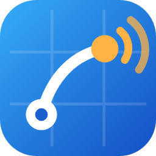

# BeamLog

**Lokaler, webbasierter Contest-Logger für UKW-Contests (DARC / IARU Region 1)**
Inoffizieller Nachfolger von DD3KU WinContest · ein Server im LAN, loggen von jedem Browser
Integrierter **ON4KST-Chat** (je Station, DMs, Rundruf) · **Aircraft-Scatter** wie AirScout direkt auf der Karte · Operator-Fenster für den zweiten Monitor

[**Download**](https://github.com/NoobKeksTV/ContestLogger/releases/latest) · [**Wiki**](docs/wiki/Home.md) · [Installation](docs/wiki/Installation.md) · [Server-Deploy](docs/wiki/Deploy.md) · [Tastenkürzel](docs/wiki/Tastenkuerzel.md) · [Fehlersuche](docs/wiki/Fehlersuche.md) · [🎬 Video](video/)

 

<a href="video/BeamLog_Promo_VoiceOver.mp4">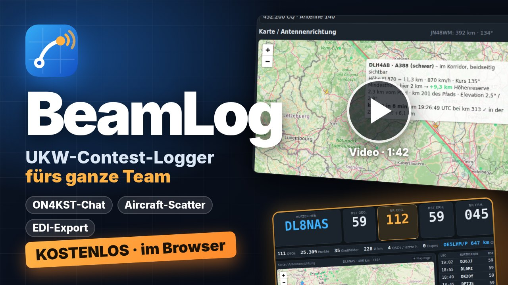</a>

🎬 <a href="video/BeamLog_Promo_VoiceOver.mp4"><b>Video ansehen</b></a> (1:42, mit Sprecherin) · <a href="video/BeamLog_Promo_Musik.mp4">nur Musik</a> · YouTube: <i>folgt</i><!-- YOUTUBE: hier den Link eintragen, z. B. <a href="https://youtu.be/XXXX">auf YouTube</a> -->

---

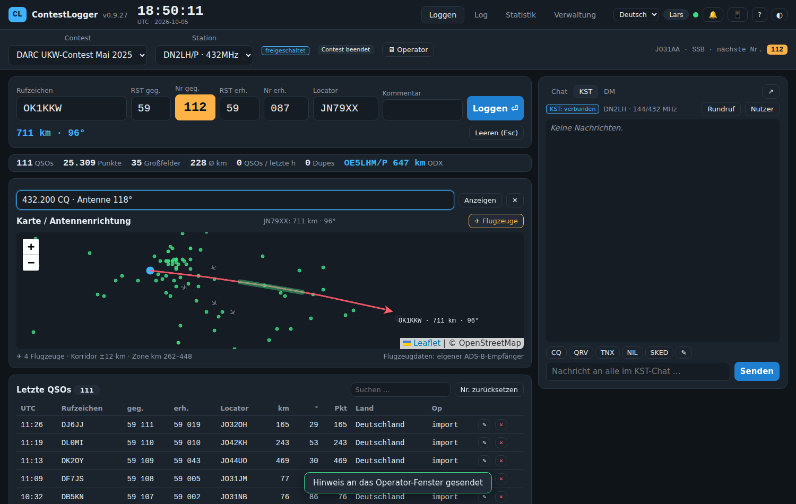

## Was ist das?

Ein kleiner Server (portable Datei, kein Python nötig) ist der zentrale Speicher für euren Contest. Alle am Standort loggen im Browser, jeder nur mit einem Nickname. Mehrere Stationen (2 m, 70 cm, 23 cm …) laufen parallel, jede mit eigenem Log, eigener laufender Nummer und eigenem ON4KST-Chat. Punkte, Dupes und Statistik rechnet der Server so wie WinContest, verifiziert gegen echte Logs.

## Funktionen

| | |
|---|---|
| **Loggen** | Rufzeichen, RST, Nummern und/oder DOK (Austausch je Contest wählbar, z. B. Köln-Aachen-Contest), Locator, Kommentar; Vorschläge aus der Stationsdatenbank und allen eigenen Logs; Locator, km und Grad automatisch; Dupe-Warnung; Plausibilitätsprüfung Rufzeichen ↔ Locator; Bearbeiten und Löschen; Zeit in UTC |
| **Stationen und Contests** | Globale Stationen mit Stammdaten (Passwort, KST-Zugang, EDI-Angaben), Contest anlegen mit Stationsauswahl, Operatoren schalten per Passwort frei |
| **Chat, ON4KST, DM** | Team-Chat je Contest (wer ist online), KST-Chat je Station (Nutzerliste mit km und Richtung, Textbausteine, „an mich“-Markierung); ein Klick auf eine Station übernimmt Rufzeichen und Locator in den Logger; Direktnachrichten wie ein Messenger, Rundruf an noch nicht gearbeitete Stationen im Umkreis |
| **Operator-Fenster** | Zweiter Monitor: live Rufzeichen, Nummern, RST, Locator, Entfernung/Richtung, Dupe-Warnung, Hinweis vom Logger, Statistik, Karte, letzte QSOs |
| **Karte** | Richtungspfeil zum Partner, alle QSOs, Großfelder mit Rufzeichen, Offline-Kachelcache mit Vorab-Laden; **Flugzeug-Scatter** (ADS-B, wie AirScout): Zone gemeinsamer Sichtbarkeit, Flugzeuge im Korridor, Mindesthöhe und Höhenreserve, vorhergesagte Kreuzungszeit und -punkt, Größenklasse, Höhenprofil des Pfads; Klick in der Liste springt zum Flugzeug |
| **Statistik** | Contest gesamt und je Station: Stundenverlauf, Entfernungs- und Richtungsverteilung, Großfelder, Länder, ODX, Großanzeige |
| **Import** | WinContest-Ordner (`.mdb` ohne Zusatzsoftware, `.txt`, `.EXP`), EDI, ADIF, Ergebnislisten (DARC/IARU), DARC-Contest-Hub direkt |
| **Export / Abgabe** | EDI (REG1TEST) mit Pflicht-Log-Prüfung und Online-Abgleich (HamQTH/QRZ), Cabrillo, ADIF, CSV, alle Bänder als ZIP; Wertung je Contest (km oder Punkte je QSO, Multiplikator Großfelder/DOKs) |
| **Stationsdatenbank** | Rufzeichen, Locator, Name, DOK; wächst mit jedem QSO, der KST-Nutzerliste, Importen (DARC-Hub mit DOK) und Online-Abfragen; Export und Abgleich mit dem Repo |
| **CAT / CW** | Frequenz vom Funkgerät (Hamlib, flrig), Sprachbausteine F2–F8 als CW |
| **Betrieb** | Backups auf dem Server (crash-sicher), Aktionsprotokoll, Update-Prüfung mit Selbst-Aktualisierung, „Was ist neu“, mehrsprachig, hell/dunkel, Hilfe mit F1 |

## Schnellstart

1. [ZIP für dein System laden](https://github.com/NoobKeksTV/ContestLogger/releases/latest) und entpacken.
2. `ContestLogger.exe` (Windows) bzw. `./ContestLogger` (Linux/macOS) starten. *(BeamLog hieß früher „ContestLogger“ – Programmdateien und GitHub-Projekt tragen weiterhin diesen Namen, damit Updates nahtlos funktionieren.)* Der Browser öffnet `http://localhost:8000`; andere Rechner nutzen die beim Start angezeigte LAN-Adresse oder den QR-Code (📱).
3. Admin-Passwort festlegen, unter **Verwaltung** die Stationen anlegen und den ersten Contest erstellen.
4. Im Reiter **Loggen** Station wählen und loslegen. F1 zeigt alle Tastenkürzel.

Dauerhafte Einstellungen (Port, Datenbank, Adresse für den QR-Code …) stehen in `contestlogger.env` neben dem Programm (Vorlage `contestlogger.env.example`). Für einen dauerhaft laufenden Server (Debian, nginx, systemd): im Linux-ZIP liegt `deploy/`, Einstellungen dann in `/etc/contestlogger/contestlogger.env`, Anleitung im [Wiki](docs/wiki/Deploy.md).

Aus dem Quellcode: `pip install -r requirements.txt && python run.py` (Python 3.11+).

## Bilder

| Operator-Fenster für den zweiten Monitor | Flugzeug-Scatter auf der Karte |
|:---:|:---:|
| 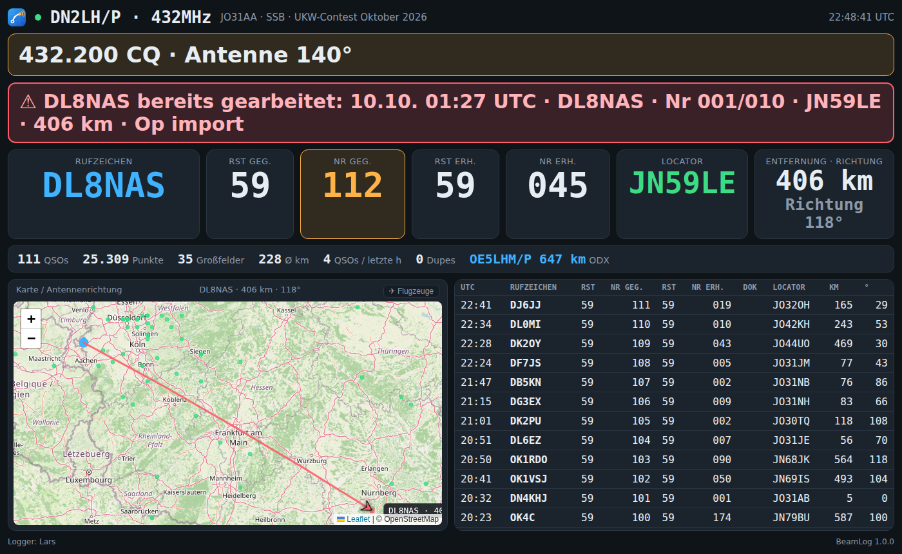 | 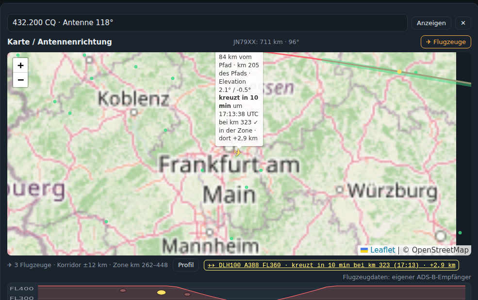 |
| **ON4KST-Chat je Station** | **Direktnachrichten** |
| 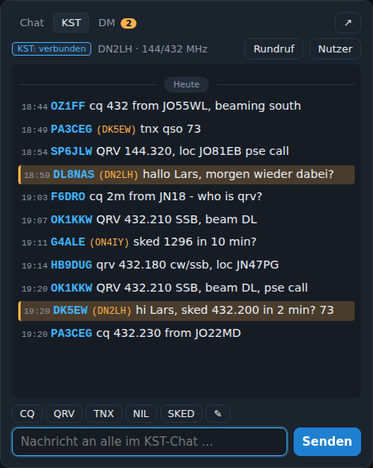 | 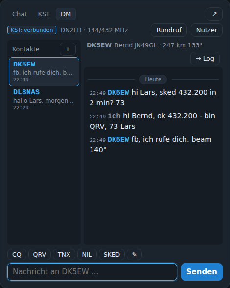 |
| **Log-Prüfung vor der EDI-Abgabe** | **Rundruf an Stationen im Umkreis** |
| 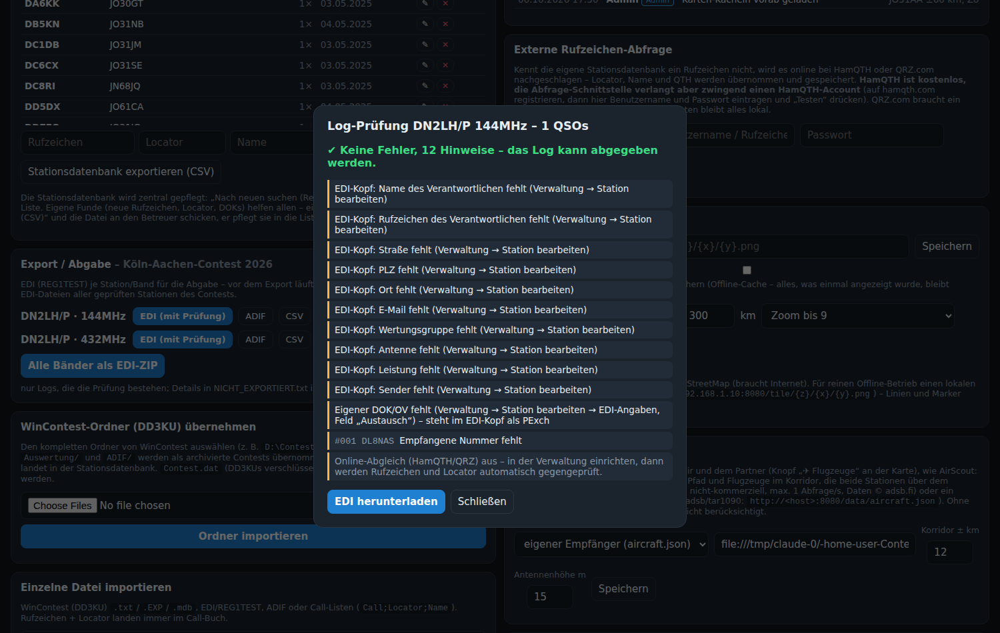 | 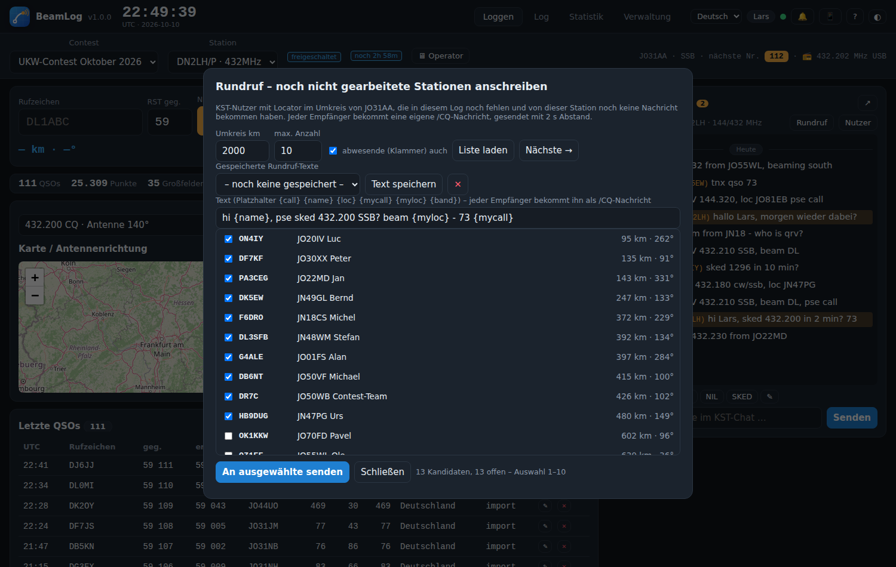 |
| **ON4KST: Nutzerliste mit km/Richtung, Nachricht an mich** | **Team-Chat zwischen den Plätzen** |
| 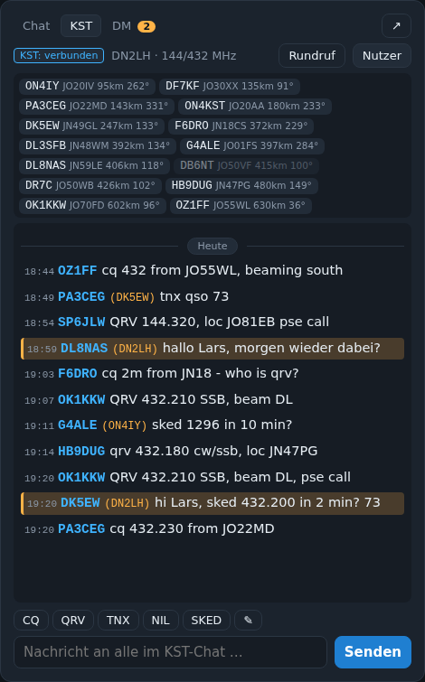 |  |
| **Dupe-Warnung mit Daten des ersten QSOs** | **Flugzeugliste und Höhenprofil** |
| 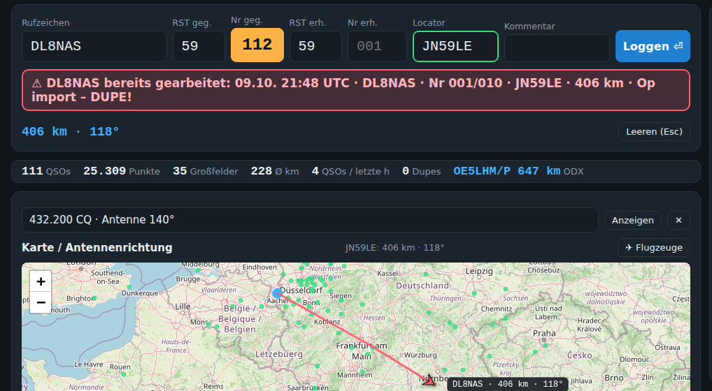 | 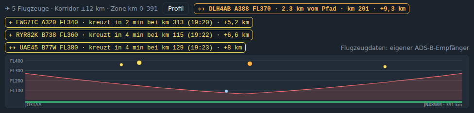 |
| **Stationsdatenbank** | **Großfeld auf der Statistik-Karte** |
| 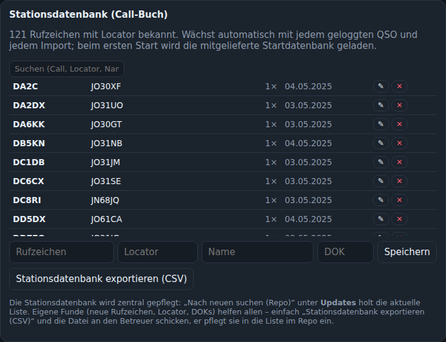 | 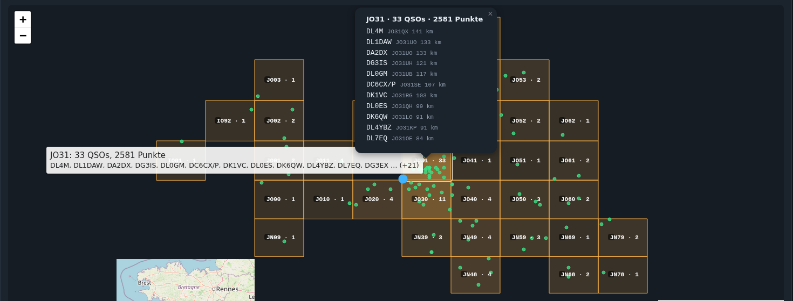 |

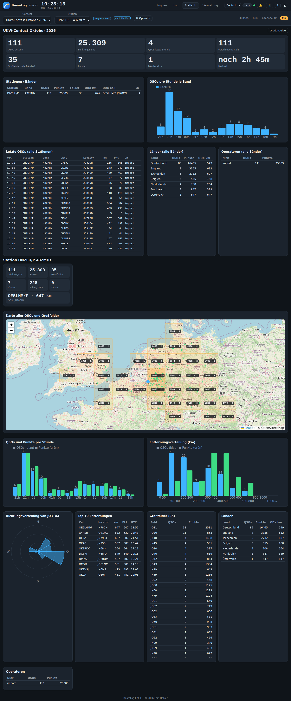 Statistik mit Karte, Großfeldern und Diagrammen

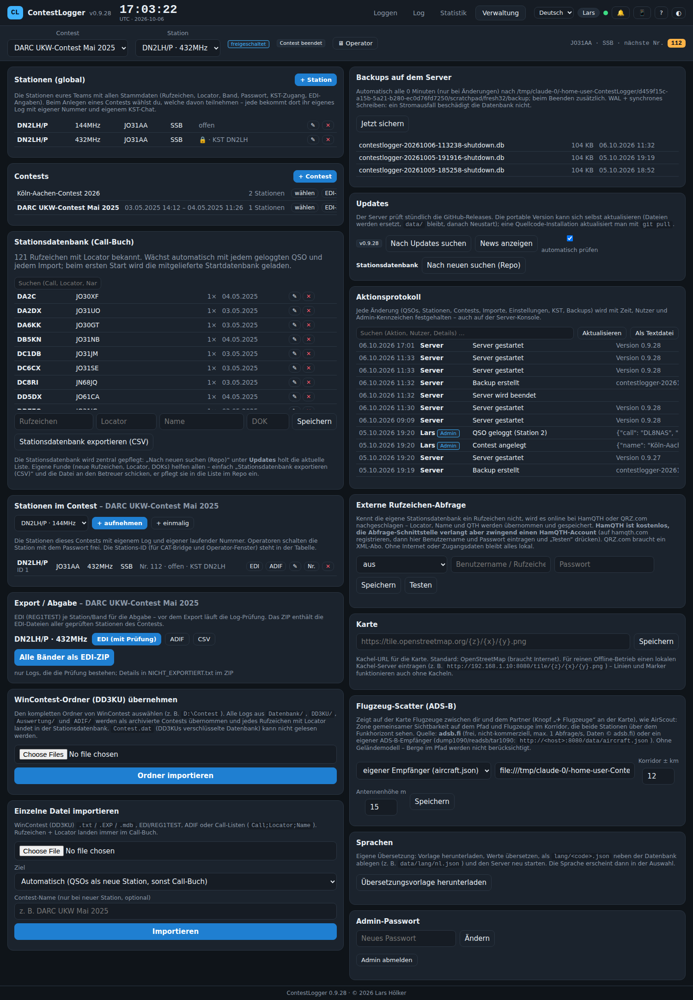 Verwaltung: Contests &amp; Stationen (weitere Bereiche: Stationsdatenbank &amp; Import, Server &amp; Updates, Einstellungen)

## Dokumentation

Das [Wiki](docs/wiki/Home.md) erklärt alles ausführlich: [Installation](docs/wiki/Installation.md), [Server-Deploy](docs/wiki/Deploy.md), [Erste Schritte](docs/wiki/Erste-Schritte.md), [Loggen](docs/wiki/Loggen.md), [Tastenkürzel](docs/wiki/Tastenkuerzel.md), [Chat/KST/DM](docs/wiki/Chat-KST.md), [Operator-Fenster](docs/wiki/Operator-Fenster.md), [Statistik](docs/wiki/Statistik.md), [Import/Export](docs/wiki/Import-Export.md), [Log-Prüfung](docs/wiki/Log-Pruefung.md), [Stationsdatenbank](docs/wiki/Stationsdatenbank.md), [Flugzeug-Scatter](docs/wiki/Flugzeug-Scatter.md), [CAT/CW](docs/wiki/CAT.md), [Verwaltung](docs/wiki/Verwaltung.md), [Updates](docs/wiki/Updates.md), [Fehlersuche](docs/wiki/Fehlersuche.md).

## Technik

Python 3.11, FastAPI + uvicorn, SQLite (WAL, synchron), WebSockets, Vanilla JS/HTML/CSS, Leaflet (lokal gebündelt), PyInstaller-Builds über GitHub Actions. Tests: `python -m pytest -q`. Portable Pakete: `python build_tools/build.py`.

Datenquellen: Flugzeuge von [adsb.fi](https://adsb.fi) (nicht-kommerziell) oder einem eigenen ADS-B-Empfänger; Karten von [OpenStreetMap](https://www.openstreetmap.org); Ergebnislisten vom [DARC-Contest-Hub](https://dxhf2.darc.de).

## Lizenz und Copyright

© 2026 Lars Hölker (DN2LH). Siehe [LICENSE](LICENSE).

---

Made by Lars Hölker (DN2LH), geholfen von Claude · 73!

