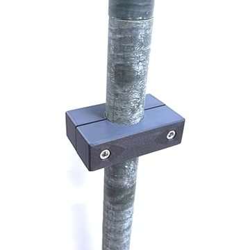
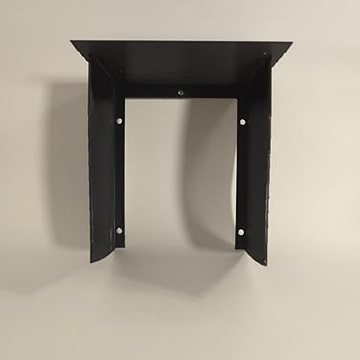
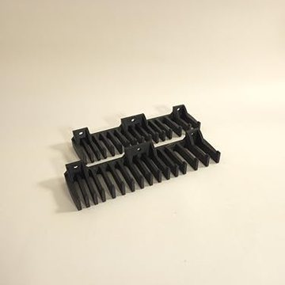
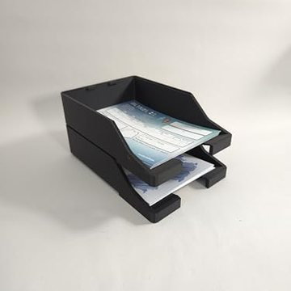

<div align="center">


# BeamLog

**Lokaler, webbasierter Contest-Logger für UKW-Contests (DARC / IARU Region 1)**
Basiert auf DD3KU WinContest · ein Server im LAN, loggen von jedem Browser
Integrierter **ON4KST-Chat** (je Station, DMs, Rundruf) · **Aircraft-Scatter** wie AirScout direkt auf der Karte · Operator-Fenster für den zweiten Monitor

[](https://github.com/NoobKeksTV/BeamLog/releases/latest)
[](https://github.com/NoobKeksTV/BeamLog/actions/workflows/build.yml)
[](https://github.com/NoobKeksTV/BeamLog/releases)
[](https://github.com/NoobKeksTV/BeamLog/commits/main)
[](https://www.python.org/)
[](https://github.com/NoobKeksTV/BeamLog/releases/latest)
[](https://beamlogdemo.lhprinting.de/)
[](LICENSE)
[](https://github.com/NoobKeksTV/BeamLog/stargazers)

[**Download**](https://github.com/NoobKeksTV/BeamLog/releases/latest) · [**Live-Demo**](https://beamlogdemo.lhprinting.de/) · [**Wiki**](https://github.com/NoobKeksTV/BeamLog/wiki) · [Installation](https://github.com/NoobKeksTV/BeamLog/wiki/Installation) · [Server-Deploy](https://github.com/NoobKeksTV/BeamLog/wiki/Deploy) · [Tastenkürzel](https://github.com/NoobKeksTV/BeamLog/wiki/Tastenkuerzel) · [Fehlersuche](https://github.com/NoobKeksTV/BeamLog/wiki/Fehlersuche)

<br>

<!-- YOUTUBE: sobald das Video online ist, das Bild verlinken: <a href="https://youtu.be/XXXX"></a> -->


<sub>🎬 Das Video „BeamLog in 1:42 Minuten“ erscheint in Kürze auf YouTube.</sub>

</div>

---


## Was ist das?

Ein kleiner Server (portable Datei, kein Python nötig) ist der zentrale Speicher für euren Contest. Alle am Standort loggen im Browser, jeder nur mit einem Nickname. Mehrere Stationen (2 m, 70 cm, 23 cm …) laufen parallel, jede mit eigenem Log, eigener laufender Nummer und eigenem ON4KST-Chat. Punkte, Dupes und Statistik rechnet der Server so wie WinContest, verifiziert gegen echte Logs.

## Funktionen

| | |
|---|---|
| **Loggen** | Rufzeichen, RST, Nummern und/oder DOK (Austausch je Contest wählbar, z. B. Köln-Aachen-Contest), Locator, Kommentar; Vorschläge aus der Stationsdatenbank und allen eigenen Logs; Locator, km und Grad automatisch; Dupe-Warnung; Plausibilitätsprüfung Rufzeichen ↔ Locator; Bearbeiten und Löschen; Zeit in UTC |
| **Stationen und Contests** | Globale Stationen mit Stammdaten (Passwort, KST-Zugang, EDI-Angaben), Contest anlegen mit Stationsauswahl, Operatoren schalten per Passwort frei |
| **Chat, ON4KST, DM** | Team-Chat je Contest (wer ist online), KST-Chat je Station (Nutzerliste mit km und Richtung, Textbausteine, „an mich“-Markierung); ein Klick auf eine Station übernimmt Rufzeichen und Locator in den Logger; Direktnachrichten wie ein Messenger, Rundruf an noch nicht gearbeitete Stationen im Umkreis |
| **Operator-Fenster** | Zweiter Monitor: live Rufzeichen, Nummern, RST, Locator, Entfernung/Richtung, Dupe-Warnung, Hinweis vom Logger, Statistik, Karte, letzte QSOs |
| **Karte** | Richtungspfeil zum Partner, alle QSOs, Großfelder mit Rufzeichen, Offline-Kachelcache mit Vorab-Laden; **Flugzeug-Scatter** (ADS-B, wie AirScout): Zone gemeinsamer Sichtbarkeit, Flugzeuge im Korridor, Mindesthöhe und Höhenreserve, vorhergesagte Kreuzungszeit und -punkt, Größenklasse, Höhenprofil des Pfads; Klick in der Liste springt zum Flugzeug |
| **Statistik** | Contest gesamt und je Station: Stundenverlauf, Entfernungs- und Richtungsverteilung, Großfelder, Länder, ODX, Großanzeige |
| **Import** | WinContest-Ordner (`.mdb` ohne Zusatzsoftware, `.txt`, `.EXP`), EDI, ADIF, Ergebnislisten (DARC/IARU), DARC-Contest-Hub direkt |
| **Export / Abgabe** | EDI (REG1TEST) mit Pflicht-Log-Prüfung und Online-Abgleich (HamQTH/QRZ), Cabrillo, ADIF, CSV, alle Bänder als ZIP; Wertung je Contest (km oder Punkte je QSO, Multiplikator Großfelder/DOKs) |
| **Stationsdatenbank** | Rufzeichen, Locator, Name, DOK; wächst mit jedem QSO, der KST-Nutzerliste, Importen (DARC-Hub mit DOK) und Online-Abfragen; Export und Abgleich mit dem Repo |
| **CAT / CW** | Frequenz vom Funkgerät (Hamlib, flrig), Sprachbausteine F2–F8 als CW |
| **Betrieb** | Backups auf dem Server (crash-sicher), Aktionsprotokoll, Update-Prüfung mit Selbst-Aktualisierung, „Was ist neu“, mehrsprachig, hell/dunkel, Hilfe mit F1 |

## Live-Demo

Ohne Installation ausprobieren: **[beamlogdemo.lhprinting.de](https://beamlogdemo.lhprinting.de/)** – eine öffentliche BeamLog-Instanz mit
Beispiel-Contest zum Herumklicken (Loggen, Karte, Statistik, Operator-Fenster). Alles, was du dort einträgst, ist für
andere Besucher sichtbar und wird täglich zurückgesetzt – bitte keine echten Logs oder Passwörter verwenden.
Admin- und Stations-Passwort: `demo`. Eine eigene Demo-Instanz einrichten: [Wiki › Server-Deploy](https://github.com/NoobKeksTV/BeamLog/wiki/Deploy#öffentliche-demo-instanz).

## Schnellstart

1. [ZIP für dein System laden](https://github.com/NoobKeksTV/BeamLog/releases/latest) und entpacken.
2. `BeamLog.exe` (Windows) bzw. `./BeamLog` (Linux/macOS) starten. Der Browser öffnet `http://localhost:8000`; andere Rechner nutzen die beim Start angezeigte LAN-Adresse oder den QR-Code (📱).
3. Admin-Passwort festlegen, unter **Verwaltung** die Stationen anlegen und den ersten Contest erstellen.
4. Im Reiter **Loggen** Station wählen und loslegen. F1 zeigt alle Tastenkürzel.

> **Umstieg von ContestLogger 0.9.x:** BeamLog hieß bis Version 0.9 „ContestLogger“. Version 1.0 einmal von Hand laden und entpacken – liegt der neue Ordner `BeamLog` neben dem alten Ordner `ContestLogger` (oder darin), übernimmt BeamLog beim ersten Start automatisch eine Kopie von `data/` und `contestlogger.env` (die Datenbank heißt danach `beamlog.db`, die Einstellungen `beamlog.env`). Ab 1.0 aktualisiert sich BeamLog wieder selbst; alte Links auf das GitHub-Projekt leiten weiter.

Dauerhafte Einstellungen (Port, Datenbank, Adresse für den QR-Code …) stehen in `beamlog.env` neben dem Programm (Vorlage `beamlog.env.example`). Für einen dauerhaft laufenden Server (Debian, nginx, systemd): im Linux-ZIP liegt `deploy/`, Einstellungen dann in `/etc/beamlog/beamlog.env`, Anleitung im [Wiki](https://github.com/NoobKeksTV/BeamLog/wiki/Deploy).

Aus dem Quellcode: `pip install -r requirements.txt && python run.py` (Python 3.11+).

## Bilder

| Operator-Fenster für den zweiten Monitor | Flugzeug-Scatter auf der Karte |
|:---:|:---:|
|  |  |
| **ON4KST-Chat je Station** | **Direktnachrichten** |
|  |  |
| **Log-Prüfung vor der EDI-Abgabe** | **Rundruf an Stationen im Umkreis** |
|  |  |
| **ON4KST: Nutzerliste mit km/Richtung, Nachricht an mich** | **Team-Chat zwischen den Plätzen** |
|  |  |
| **Dupe-Warnung mit Daten des ersten QSOs** | **Flugzeugliste und Höhenprofil** |
|  |  |
| **Stationsdatenbank** | **Großfeld auf der Statistik-Karte** |
|  |  |

<p align="center"><br><sub>Statistik mit Karte, Großfeldern und Diagrammen</sub></p>
<p align="center"><br><sub>Verwaltung: Contests &amp; Stationen (weitere Bereiche: Stationsdatenbank &amp; Import, Server &amp; Updates, Einstellungen)</sub></p>

## Dokumentation

Das [Wiki](https://github.com/NoobKeksTV/BeamLog/wiki) erklärt alles ausführlich: [Installation](https://github.com/NoobKeksTV/BeamLog/wiki/Installation), [Server-Deploy](https://github.com/NoobKeksTV/BeamLog/wiki/Deploy), [Erste Schritte](https://github.com/NoobKeksTV/BeamLog/wiki/Erste-Schritte), [Loggen](https://github.com/NoobKeksTV/BeamLog/wiki/Loggen), [Tastenkürzel](https://github.com/NoobKeksTV/BeamLog/wiki/Tastenkuerzel), [Chat/KST/DM](https://github.com/NoobKeksTV/BeamLog/wiki/Chat-KST), [Operator-Fenster](https://github.com/NoobKeksTV/BeamLog/wiki/Operator-Fenster), [Statistik](https://github.com/NoobKeksTV/BeamLog/wiki/Statistik), [Import/Export](https://github.com/NoobKeksTV/BeamLog/wiki/Import-Export), [Log-Prüfung](https://github.com/NoobKeksTV/BeamLog/wiki/Log-Pruefung), [Stationsdatenbank](https://github.com/NoobKeksTV/BeamLog/wiki/Stationsdatenbank), [Flugzeug-Scatter](https://github.com/NoobKeksTV/BeamLog/wiki/Flugzeug-Scatter), [CAT/CW](https://github.com/NoobKeksTV/BeamLog/wiki/CAT), [Verwaltung](https://github.com/NoobKeksTV/BeamLog/wiki/Verwaltung), [Updates](https://github.com/NoobKeksTV/BeamLog/wiki/Updates), [Fehlersuche](https://github.com/NoobKeksTV/BeamLog/wiki/Fehlersuche).

## Technik

Python 3.11, FastAPI + uvicorn, SQLite (WAL, synchron), WebSockets, Vanilla JS/HTML/CSS, Leaflet (lokal gebündelt), PyInstaller-Builds über GitHub Actions. Tests: `python -m pytest -q`. Portable Pakete: `python build_tools/build.py`.

Datenquellen: Flugzeuge von [adsb.fi](https://adsb.fi) (nicht-kommerziell) oder einem eigenen ADS-B-Empfänger; Karten von [OpenStreetMap](https://www.openstreetmap.org); Ergebnislisten vom [DARC-Contest-Hub](https://dxhf2.darc.de).

## Zubehör von LH Printing

<sub>Eigenwerbung – BeamLog bleibt kostenlos und frei. Wer das Projekt unterstützen möchte: Lars Hölker (DN2LH) betreibt
mit **[LH Printing](https://lhprinting.de/?utm_source=github&utm_medium=readme&utm_campaign=beamlog)** eine kleine 3D-Druckerei, unter anderem mit Zubehör für Funkamateure.</sub>

<table>
<tr>
<td align="center" width="25%">
<a href="https://lhprinting.de/produkte/SX-4S6S-FOXA?utm_source=github&utm_medium=readme&utm_campaign=beamlog"></a><br>
<b>Mastschellen 35 mm</b><br>
<sub>Für Masten und Antennen, mit V2A-Edelstahlschrauben M6, wetterfest – ideal für Portabel- und Fieldday-Aufbauten</sub><br>
<a href="https://lhprinting.de/produkte/SX-4S6S-FOXA?utm_source=github&utm_medium=readme&utm_campaign=beamlog">Zum Shop →</a>
</td>
<td align="center" width="25%">
<a href="https://lhprinting.de/produkte/4D-JN23-QASW?utm_source=github&utm_medium=readme&utm_campaign=beamlog"></a><br>
<b>Wetterschutzgehäuse</b><br>
<sub>Outdoor-Gehäuse für Kamera, Außensteckdose oder Sensor – hält Regen ab, 137 × 104 × 90 mm</sub><br>
<a href="https://lhprinting.de/produkte/4D-JN23-QASW?utm_source=github&utm_medium=readme&utm_campaign=beamlog">Zum Shop →</a>
</td>
<td align="center" width="25%">
<a href="https://lhprinting.de/produkte/ordner/fld_1778880175338?v=3D-KAB-SCH&utm_source=github&utm_medium=readme&utm_campaign=beamlog"></a><br>
<b>Messleitungshalter</b><br>
<sub>Ordnung im Shack, Labor und in der Werkstatt: Wandhalter für Messleitungen und Kabel 4–10 mm, 2 Stück</sub><br>
<a href="https://lhprinting.de/produkte/ordner/fld_1778880175338?v=3D-KAB-SCH&utm_source=github&utm_medium=readme&utm_campaign=beamlog">Zum Shop →</a>
</td>
<td align="center" width="25%">
<a href="https://lhprinting.de/produkte/KS-H30M-N5P6?utm_source=github&utm_medium=readme&utm_campaign=beamlog"></a><br>
<b>QSL-Kartenablage</b><br>
<sub>Stapelbare Ablage für QSL-Karten und Postkarten – damit nach dem Contest nichts liegen bleibt</sub><br>
<a href="https://lhprinting.de/produkte/KS-H30M-N5P6?utm_source=github&utm_medium=readme&utm_campaign=beamlog">Zum Shop →</a>
</td>
</tr>
</table>

Alle Amateurfunk-Artikel: **[lhprinting.de › Amateurfunk](https://lhprinting.de/produkte?kategorie=Amateurfunk&utm_source=github&utm_medium=readme&utm_campaign=beamlog)** · Sonderwünsche (eigene Halter,
Gehäuse, Adapter) über die [Anfrage](https://lhprinting.de/anfragen?utm_source=github&utm_medium=readme&utm_campaign=beamlog).

## Lizenz und Copyright

BeamLog ist freie Software unter der **[GNU Affero General Public License v3.0](LICENSE)** (GNU AGPLv3).

```
BeamLog – Contest-Logger für UKW-Contests
Copyright (C) 2026 Lars Hölker (DN2LH)

This program is free software: you can redistribute it and/or modify it under the terms of the
GNU Affero General Public License as published by the Free Software Foundation, version 3.

This program is distributed in the hope that it will be useful, but WITHOUT ANY WARRANTY; without
even the implied warranty of MERCHANTABILITY or FITNESS FOR A PARTICULAR PURPOSE. See the
GNU Affero General Public License for more details: https://www.gnu.org/licenses/agpl-3.0
```

Kurz gesagt: Nutzen, weitergeben und verändern ist erlaubt. Wer eine veränderte Version weitergibt **oder anderen über
das Netz (z. B. als Server im LAN oder Internet) zur Verfügung stellt**, muss deren Quellcode ebenfalls unter der AGPLv3
offenlegen. Der Link „Quellcode“ in der Fußzeile der Oberfläche zeigt auf dieses Projekt.

---

<div align="center"><sub>Made by Lars Hölker (DN2LH), geholfen von Claude · 73!</sub></div>
