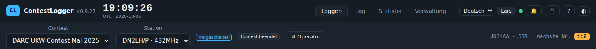

# CAT-Anbindung und CW

`BeamLog-CAT` (bzw. `tools/cat_bridge.py`) läuft auf dem Rechner, an dem das Funkgerät hängt, und meldet die Frequenz an den Server. Sie erscheint in der Stationsleiste, im Operator-Fenster und wird je QSO gespeichert (ADIF `FREQ`).



## Voraussetzungen

- Hamlib `rigctld` (z. B. `rigctld -m 3073 -r COM5 -s 38400`) oder flrig.
- Die Stations-ID (Verwaltung → Stationstabelle) und das Stations-Passwort.

## Start

```
BeamLog-CAT --server http://192.168.1.10:8000 --station 1 --password 70cm
BeamLog-CAT --server http://192.168.1.10:8000 --station 1 --password 70cm --rigctld 127.0.0.1:4532
BeamLog-CAT --server http://192.168.1.10:8000 --station 1 --password 70cm --flrig 127.0.0.1:12345
```

Die Bridge fragt die Frequenz alle paar Sekunden ab und meldet Änderungen.

## CW über die Bridge

Mit `--cw` holt die Bridge die Sprachbausteine (F2–F8) vom Server ab und gibt sie über rigctld als CW aus. Esc im Logger stoppt die laufende Ausgabe. Die Texte mit Platzhaltern (`{call} {rst} {nr} …`) werden vor dem Senden ausgefüllt.

## Hinweise

- Pro Station eine Bridge. Läuft keine Bridge, fehlt lediglich die Frequenzanzeige.
- Die Bridge braucht nur HTTP zum Server (Port 8000 bzw. nginx auf 80).
