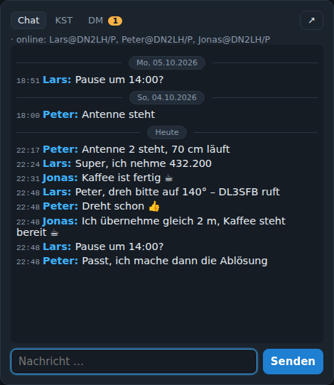

# Chat, ON4KST und Direktnachrichten

Rechts neben dem Logger sitzt das Chat-Fenster mit drei Reitern: **Chat** (lokal), **KST** (ON4KST-Chat der Station) und **DM** (Direktnachrichten). Jeder Reiter zeigt einen Zähler für ungelesene Nachrichten. Mit ↗ lässt sich das Chat-Fenster in ein eigenes Browserfenster auslagern.

## Lokaler Chat

Chat für alle, die am Server angemeldet sind, getrennt je Contest. Der Verlauf liegt auf dem Server und ist nach dem Neuladen oder an einem anderen PC wieder da. Die Anwesenheitsliste im Kopf zeigt, wer gerade an welcher Station sitzt.

## ON4KST-Chat

Der Server verbindet sich per Telnet mit dem ON4KST-Chat (`www.on4kst.info:23000`) – **je Station eine eigene Verbindung** mit eigenem Login und Raum. Einrichten: Verwaltung → Station bearbeiten → „ON4KST-Chat dieser Station“:

| Feld | Bedeutung |
|---|---|
| KST-Rufzeichen / Passwort | Der ON4KST-Login (ein eigenes KST-Passwort verwenden, es geht im Klartext über das Netz). |
| Raum | 2 = 144/432 MHz, 3 = Mikrowelle, 1 = 50/70 MHz, … |
| „An mich“-Rufzeichen | Zusätzliche Rufzeichen, bei denen Nachrichten als an dich gerichtet gelten. KST-Login und Stations-Call zählen immer; Zusätze wie `/P` oder `-2` werden ignoriert. |
| beim Serverstart verbinden | Verbindung wird beim Start des Servers automatisch aufgebaut. |
| Verbinden / Trennen / Rohdaten | Steuerung und die letzten 500 Rohzeilen der Verbindung zur Fehlersuche. |

Im KST-Tab:

- Eigene Nachrichten sind blau markiert, Nachrichten an dich orange (mit Pling und Zähler).
- Klick auf ein Rufzeichen übernimmt Rufzeichen und Locator in den Logger.
- Die **Textbausteine** unter dem Verlauf (CQ, QRV, TNX …) gehen im KST-Tab unadressiert an alle; im DM-Tab an den offenen Kontakt. Bearbeiten mit ✎. Platzhalter: `{call} {name} {loc}` (Ziel) und `{mycall} {myloc} {band}` (eigene Station).
- **Nutzer**: Nutzerliste des Raums mit Locator, Entfernung und Richtung. Sie wird alle 10 Minuten automatisch geholt; jeder Nutzer mit Locator landet in der Stationsdatenbank.
- Die Verbindung baut sich nach einem Netzausfall selbst wieder auf; den beim Anmelden wiederholten Verlauf erkennt der Server und speichert ihn nicht doppelt.

Der KST-Server erlaubt nur ein Kommando (z. B. `/SHOW USER`) pro Minute; Nachrichten sind unbegrenzt.

## Direktnachrichten (DM)

Wie ein Messenger: links die Kontakte, sortiert nach letzter Aktivität, rechts das Gespräch. Es zeigt nur Nachrichten zwischen dir und dem Kontakt. Die Eingabe geht automatisch als `/CQ CALL …` an den Kontakt. „+“ legt ein neues Gespräch an. Lesemarken liegen auf dem Server (je Station und Nickname).

Schreibst du jemanden über einen **anderen KST-Client** mit demselben Login an, öffnet sich das Gespräch hier automatisch – außer du bist gerade in einem anderen aktiv (Text in der Eingabe oder Nachrichten in den letzten 3 Minuten).

Im Gesprächskopf: Klick auf das Rufzeichen oder „→ Log“ übernimmt Call und Locator in den Logger.

## Rundruf

Spricht gezielt KST-Nutzer im Umkreis an, die in diesem Log noch fehlen:

1. Umkreis in km, maximale Anzahl, abwesende (in Klammern) optional.
2. „Liste laden“ holt die Kandidaten (sortiert nach Entfernung). Ausgeschlossen: bereits geloggte Rufzeichen, eigene Rufzeichen, der Chat-Server selbst und alle, die von dieser Station schon eine gerichtete Nachricht bekommen haben.
3. Text wählen oder eingeben; eigene Texte lassen sich speichern (für alle Operatoren). Platzhalter wie bei den Textbausteinen.
4. „An ausgewählte senden“ schickt jedem Empfänger eine eigene `/CQ`-Nachricht mit 2 s Abstand; die Sendeliste zeigt, wer schon dran war.
5. „Nächste →“ dreht die Auswahl auf die nächsten noch nicht angeschriebenen Kandidaten.

## Tagestrenner

In allen drei Verläufen (Chat, KST, DM) steht vor der ersten Nachricht eines neuen Tages eine Trennzeile mit dem Datum („Heute“, „Gestern“, sonst Wochentag und Datum, UTC) – wie in Messengern.
