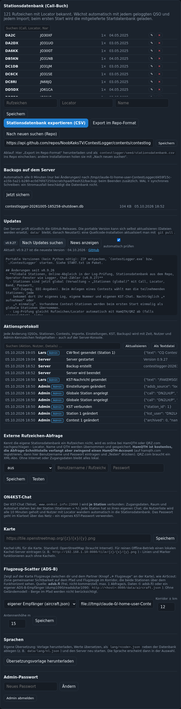

# Server-Deploy: Debian mit nginx und systemd

Für einen dauerhaft laufenden Server (z. B. Raspberry Pi oder ein kleiner Debian-Rechner im Shack) liegt im Linux-ZIP der Ordner `deploy/` mit allem Nötigen. Python wird auf dem Server **nicht** benötigt.

## Schnellinstallation

```bash
unzip ContestLogger-<version>-linux-x86_64.zip
cd ContestLogger
sudo bash deploy/install.sh --url http://contest.local/
```

Das Script

- installiert `nginx`, `sqlite3` und `rsync`,
- kopiert das Programm nach `/opt/contestlogger` und legt den Systemnutzer `contestlogger` an,
- legt die Konfiguration `/etc/contestlogger/contestlogger.env` an (Dienst auf `127.0.0.1:8000`, Datenbank in `/var/lib/contestlogger/`, Backups alle 15 Minuten),
- richtet den Dienst `contestlogger` ein (liest die Konfiguration, Neustart bei Absturz),
- legt die nginx-Site auf Port 80 mit WebSocket-Weiterleitung an,
- richtet ein tägliches gepacktes Backup (03:15 Uhr, 30 Tage) ein.

Danach läuft der Logger unter `http://<server-ip>/`. `--url` setzt die Adresse, die im QR-Code und in Links erscheint.

Die Sicherungen des Servers lassen sich in der Verwaltung einsehen und anstoßen:



**Update später:** neues ZIP entpacken und im entpackten Ordner `sudo bash deploy/install.sh --update`. Daten und Einstellungen bleiben erhalten. Alternativ aktualisiert sich der Server selbst über Verwaltung → Updates, siehe [Updates](Updates.md).

## Von Hand installieren

```bash
# 1. Programm nach /opt kopieren und Nutzer anlegen
sudo mkdir -p /opt/contestlogger /var/lib/contestlogger
sudo cp -r ./* /opt/contestlogger/
sudo useradd --system --home /opt/contestlogger --shell /usr/sbin/nologin contestlogger
sudo chown -R contestlogger:contestlogger /opt/contestlogger /var/lib/contestlogger
sudo chmod +x /opt/contestlogger/ContestLogger*

# 2. Konfiguration anlegen (Werte bei Bedarf anpassen: nano /etc/contestlogger/contestlogger.env)
sudo mkdir -p /etc/contestlogger
sudo cp /opt/contestlogger/deploy/contestlogger.env /etc/contestlogger/contestlogger.env
sudo chown root:contestlogger /etc/contestlogger/contestlogger.env && sudo chmod 640 /etc/contestlogger/contestlogger.env

# 3. systemd-Dienst kopieren, aktivieren und starten
sudo cp /opt/contestlogger/deploy/contestlogger.service /etc/systemd/system/contestlogger.service
sudo systemctl daemon-reload
sudo systemctl enable --now contestlogger

# 4. nginx-Site einrichten (Port 80 -> Dienst)
sudo apt-get install -y nginx
sudo cp /opt/contestlogger/deploy/nginx-contestlogger.conf /etc/nginx/sites-available/contestlogger
sudo ln -sf /etc/nginx/sites-available/contestlogger /etc/nginx/sites-enabled/contestlogger
sudo rm -f /etc/nginx/sites-enabled/default
sudo nginx -t && sudo systemctl reload nginx

# 5. (optional) tägliches Backup
sudo apt-get install -y sqlite3
sudo cp /opt/contestlogger/deploy/backup.sh /usr/local/bin/contestlogger-backup
sudo chmod +x /usr/local/bin/contestlogger-backup
echo "15 3 * * * root /usr/local/bin/contestlogger-backup" | sudo tee /etc/cron.d/contestlogger-backup
```

## Einstellungen: `/etc/contestlogger/contestlogger.env`

Alle Server-Einstellungen stehen in einer Datei im `.env`-Format; die Unit selbst enthält keine Optionen mehr:

```ini
HOST=127.0.0.1                                  # hinter nginx nur lokal
PORT=8000
DB=/var/lib/contestlogger/contestlogger.db
BACKUP_MIN=15                                   # automatische Sicherung alle N Minuten (0 = aus)
PUBLIC_URL=http://contest.local/                # Adresse im QR-Code und in Links
#KST_HOST=www.on4kst.info                       # ON4KST-Server (normalerweise unverändert)
#KST_PORT=23000
#GITHUB_TOKEN=                                  # nur für ein privates Repo (Updates, Stationsdatenbank)
```

Nach Änderungen `sudo systemctl restart contestlogger`. `install.sh` legt die Datei beim ersten Lauf aus `deploy/contestlogger.env` an und lässt sie bei `--update` unverändert; `--url` trägt nur `PUBLIC_URL` ein. Reihenfolge der Quellen: Kommandozeile überstimmt Umgebungsvariablen `CONTESTLOGGER_<KEY>`, diese überstimmen die Datei.

Die Unit `deploy/contestlogger.service` (Auszug):

```ini
[Service]
User=contestlogger
WorkingDirectory=/opt/contestlogger
ExecStart=/opt/contestlogger/ContestLogger --config /etc/contestlogger/contestlogger.env
Restart=always
PrivateTmp=true
ProtectSystem=strict
ReadWritePaths=/var/lib/contestlogger
```

## Ohne nginx: direkt auf Port 80

Ein normaler Nutzer darf Port 80 nicht öffnen (`[Errno 13] permission denied`). Die Unit `deploy/contestlogger-port80.service` gibt dem Dienst über `AmbientCapabilities=CAP_NET_BIND_SERVICE` genau diese Berechtigung und setzt `0.0.0.0:80` fest (alle anderen Werte kommen weiter aus `contestlogger.env`):

```bash
sudo systemctl disable --now nginx            # falls nginx Port 80 belegt
sudo cp /opt/contestlogger/deploy/contestlogger-port80.service /etc/systemd/system/contestlogger.service
sudo systemctl daemon-reload
sudo systemctl restart contestlogger
```

## nginx-Site

`deploy/nginx-contestlogger.conf` reicht alles an `127.0.0.1:8000` durch; wichtig ist der WebSocket-Block für `/ws` (Live-Updates, Chat, Operator-Fenster) und `client_max_body_size 50m` für Importe. Für HTTPS liegt im Quellcode unter `deploy/nginx-contestlogger-ssl.conf` eine Vorlage (Zertifikat z. B. per certbot oder selbstsigniert).

## Dienst bedienen

```bash
sudo systemctl start|stop|restart contestlogger
systemctl status contestlogger
journalctl -u contestlogger -f          # Live-Log, enthält auch das Aktionsprotokoll
```

## Datenbank und Backups

- Datenbank: `/var/lib/contestlogger/contestlogger.db` (SQLite, WAL-Modus, synchrones Schreiben – ein Stromausfall beschädigt sie nicht).
- Automatische Sicherungen des Servers: `/var/lib/contestlogger/backup/` (nur wenn sich etwas geändert hat, plus beim Beenden und vor jedem Update).
- Tägliche gepackte Sicherung des Cron-Jobs: `/var/lib/contestlogger/backup-daily/`.
- Eigene Sprachdateien: `/var/lib/contestlogger/lang/<code>.json`.

Wiederherstellen: Dienst stoppen, Sicherung nach `contestlogger.db` kopieren, Dienst starten.

## Quellcode-Variante auf dem Server

Wer lieber aus dem Repo installiert (Python-venv statt Binary), nutzt `deploy/install.sh` aus dem Quellcode-Checkout; dort entsteht `/opt/contestlogger/.venv`. Updates dann mit `git pull` und `sudo bash deploy/install.sh --update`.
