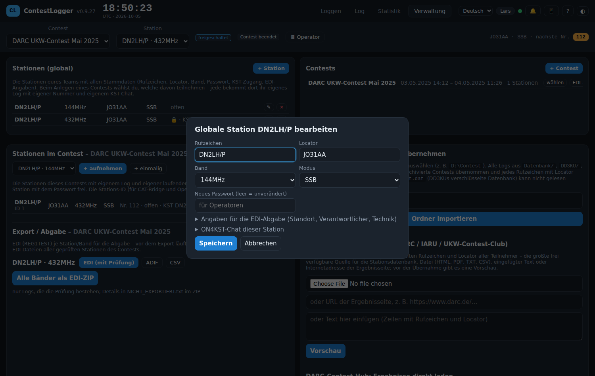
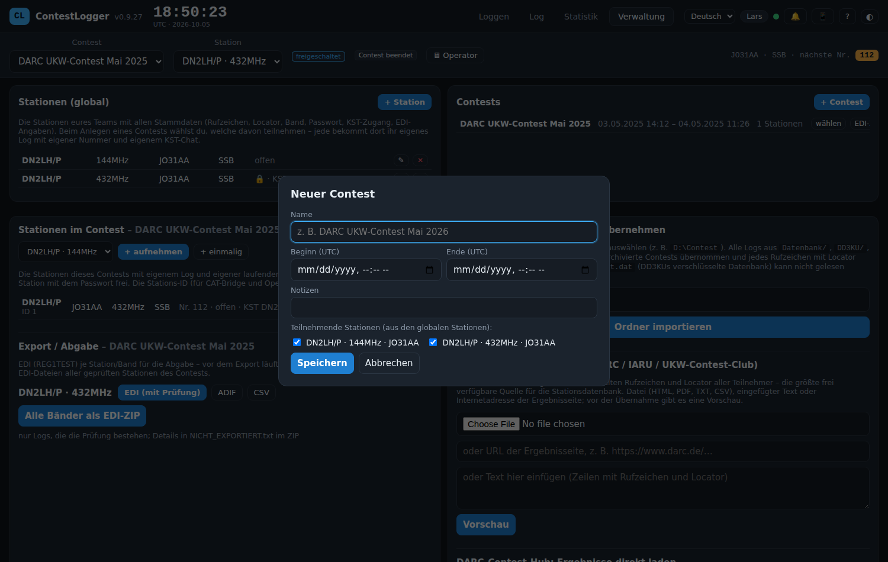

# Erste Schritte

## 1. Admin-Passwort

Beim ersten Aufruf der Oberfläche fragt ContestLogger nach einem Admin-Passwort. Es schützt die Verwaltung (Stationen, Contests, Importe, Einstellungen). Operatoren brauchen es nicht – sie melden sich nur mit einem Nickname an.

## 2. Nickname

Jeder Browser meldet sich mit einem Nickname (z. B. „Lars“). Er erscheint im Chat, in der Anwesenheitsliste („online: Lars@DN2LH/P, Peter@DN2LH“) und im Aktionsprotokoll bei jedem QSO. Ändern: Klick auf den Namen im Kopf.

## 3. Globale Stationen anlegen

Verwaltung → **Stationen (global)** → „+ Station“. Hier stehen die Stammdaten eurer Stationen, die ihr bei jedem Contest wieder braucht:

| Feld | Bedeutung |
|---|---|
| Rufzeichen, Locator, Band, Modus | Die Station, wie sie im EDI erscheint. Der Locator muss 6-stellig sein. |
| Stations-Passwort | Operatoren schalten die Station damit frei. Leer = jeder darf loggen. |
| Angaben für die EDI-Abgabe | Wertungsgruppe, Club/DOK, Verantwortlicher, Technik – wird im EDI-Kopf gebraucht; die Log-Prüfung warnt, wenn etwas fehlt. |
| ON4KST-Chat | Zugangsdaten und Raum für den KST-Chat dieser Station, siehe [Chat und KST](Chat-KST.md). |

## 4. Contest anlegen

Verwaltung → **Contests** → „+ Contest“: Name, Beginn und Ende (UTC) und die Häkchenliste der teilnehmenden globalen Stationen.

Jede gewählte Station bekommt im Contest ihr eigenes Log mit eigener laufender Nummer und eigenem KST-Chat. Später lassen sich Stationen mit „+ aufnehmen“ (aus den globalen) oder „+ einmalig“ (nur für diesen Contest) ergänzen.

## 5. Loggen

In der Leiste unter dem Kopf Contest und Station wählen. Hat die Station ein Passwort, erscheint „🔒 freischalten“; danach ist das Formular aktiv. Alles Weitere unter [Loggen](Loggen.md).

## 6. Weitere Rechner und Handys

Alle Geräte im LAN rufen dieselbe Adresse auf (QR-Code über 📱 im Kopf). Jedes Gerät kann eine andere Station bedienen; alle sehen die QSOs der anderen live im Statistik-Reiter und im Chat.

## 7. Nach dem Contest

Verwaltung → **Export / Abgabe**: „EDI (mit Prüfung)“ je Station oder „Alle Bänder als EDI-ZIP“. Vorher läuft automatisch die [Log-Prüfung](Log-Pruefung.md).
