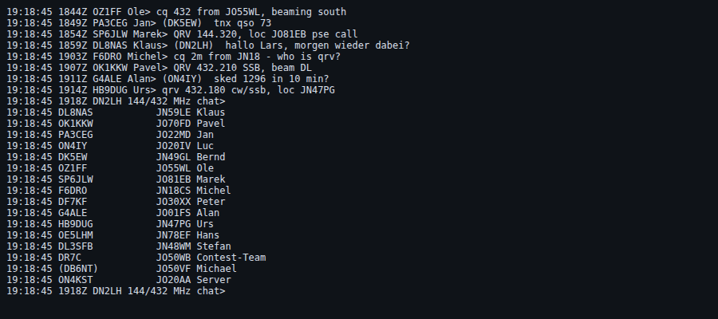

# Fehlersuche

| Problem | Ursache / Lösung |
|---|---|
| Andere Rechner erreichen den Server nicht | Firewall auf dem Server-Rechner (Port 8000 bzw. 80 freigeben, Windows: „privates Netzwerk“). Adresse mit Port eingeben: `http://192.168.1.10:8000`. |
| `GLIBC_2.xx not found` beim Start unter Linux | System zu alt (vor Debian 12 / Ubuntu 22.04). Quellcode-Variante nutzen. |
| `Failed at step EXEC spawning /opt/beamlog/.venv/bin/python` | Alte Unit-Datei vom Quellcode-Deploy auf einem portablen Server. Unit aus `deploy/beamlog.service` (im Linux-ZIP) kopieren, `daemon-reload`, Neustart. |
| Dienst startet, ignoriert aber Port/Adresse | Die Unit enthält seit v0.9.28 keine Optionen mehr; die Werte stehen in `/opt/beamlog/.env`. Fehlt die Datei (alte Installation), `sudo ./beamlogctl update` ausführen oder `deploy/server.env` dorthin kopieren. Beim Start zeigt die Konsole „Konfiguration: …“. |
| `[Errno 13] permission denied` beim Binden an Port 80 | Nicht-root darf Port 80 nicht öffnen. Server-Dienst: `sudo ./beamlogctl update` ausführen – die Unit erlaubt Port 80. Portabel ohne Dienst: Port ab 1024 wählen. |
| `PORT=80` in `.env`, Dienst läuft aber weiter auf 8000 | Nach Änderungen an Port/Adresse `sudo ./beamlogctl update` ausführen (schaltet nginx ab bzw. an und passt die Weiterleitung an). Ältere Units hatten `--port` fest im Startbefehl – das Skript übernimmt den Wert in die env-Datei. |
| Station fragt nach Passwort | Station hat ein Passwort (Verwaltung). Ohne Passwort wird automatisch freigeschaltet. |
| KST: „Anmeldung abgelehnt“ | Rufzeichen/Passwort bei der Station prüfen. Das KST-Passwort ist das vom ON4KST-Account. |
| KST: „Please wait … seconds between two commands“ | Der KST-Server erlaubt ein Kommando pro Minute; Nachrichten sind unbegrenzt. |
| KST: nach Neustart alles ungelesen oder Nachrichten doppelt | Verwaltung → Station → „Rohdaten“ zeigt, wie der Server den Verlauf schickt. Der Logger erkennt Wiederholungen; bei Abweichungen bitte die Rohdaten melden. |
| Viele Töne auf einmal | Nachrichtenschub (z. B. Verlauf nach Neuverbinden). Töne sind auf einen je 1,5 s gedrosselt; in den ersten Sekunden nach Verbindung bleibt es still. |
| HamQTH liefert nichts | HamQTH verlangt für die Abfrage-Schnittstelle einen (kostenlosen) Account; Benutzername und Passwort in der Verwaltung eintragen und „Testen“. |
| „Repo nicht erreichbar: 404“ | URL in Verwaltung → Stationsdatenbank prüfen. Nur bei einem privaten Fork: `GITHUB_TOKEN` in `.env` setzen. |
| Nach dem Update fehlen eigene Einstellungen | Die Datei heißt jetzt `.env` (früher `beamlog.env`). BeamLog und `beamlogctl update` benennen eine alte `beamlog.env` automatisch um; gibt es schon eine `.env`, bleibt die alte liegen und wird nicht mehr gelesen (Hinweis beim Start) – Werte übertragen, alte Datei löschen. |
| Einstellung in der `.env` (z. B. `MAINTAINER=1`) wirkt nicht | Startzeile „Konfiguration: …“ ansehen – steht dort eine andere Datei oder „keine .env gefunden“, liegt die `.env` am falschen Ort (neben das Programm bzw. in den Programmordner legen). Windows: Datei heißt evtl. `.env.txt` (wird ab 1.0.2 selbst umbenannt). Versionen bis 1.0.0 lesen nur `beamlog.env`. `MAINTAINER`/`DEV` wirken im Demo-Modus (`DEMO=1`) nie. Danach neu starten. |
| Einstellung (Port, Adresse) wirkt nicht | Reihenfolge: Kommandozeile > Umgebungsvariable `BEAMLOG_<KEY>` > `.env`. Beim Start steht „Konfiguration: …“, welche Datei gelesen wurde; Server: `/opt/beamlog/.env`, danach `sudo ./beamlogctl restart`. |
| ServerController o. ä. zeigt „gestoppt“, BeamLog läuft aber | `./beamlogctl status; echo $?` im BeamLog-Ordner zeigt den Grund. Häufig: falscher Port (Formular ↔ `PORT=` in `.env`) oder BeamLog läuft unter einem anderen Benutzer – dann einmal `sudo ./beamlogctl stop` und über das Panel starten. Befehle mit `exit` nie direkt in die eigene Shell kopieren: sie schließt sich (PuTTY geht zu). |
| `sh: cannot open beamlogctl: No such file` | Der Ordner ist auf einem Stand vor `beamlogctl`. Einmal `git pull` (bzw. Update im Panel) oder die Datei holen: `curl -fsSL https://raw.githubusercontent.com/NoobKeksTV/BeamLog/main/beamlogctl -o beamlogctl`. |
| F-Tasten bzw. alte Oberfläche nach einem Update | Das Programm lädt `app.js` mit einem Fingerabdruck seines Inhalts neu; einmal die Seite neu laden (Strg+F5). Sitzt Cloudflare o. ä. davor, wird die neue Datei automatisch geholt. |
| Karte ohne Kacheln | Kein Internet oder Kachelserver nicht erreichbar. Linien und Marker funktionieren trotzdem; für Offline-Betrieb eigenen Kachelserver eintragen. |
| EDI-Export verweigert | Log-Prüfung hat Fehler gefunden; Einträge anklicken und beheben. Admin kann erzwingen. |
| Flugzeuge: „ADS-B-Quelle nicht erreichbar“ | Server hat kein Internet (adsb.fi) oder die URL des eigenen Empfängers stimmt nicht. |

Die Rohdaten der KST-Verbindung (Verwaltung → Station ✎ → „Rohdaten“) zeigen jede Zeile, die der Server vom ON4KST-Chat erhalten hat:

Logs: Server-Konsole bzw. `journalctl -u beamlog -f`; dort steht auch das Aktionsprotokoll. Die Datenbank liegt in `data/beamlog.db` (portable) bzw. `/opt/beamlog/data/beamlog.db` (Server), Sicherungen daneben in `backup/`.
