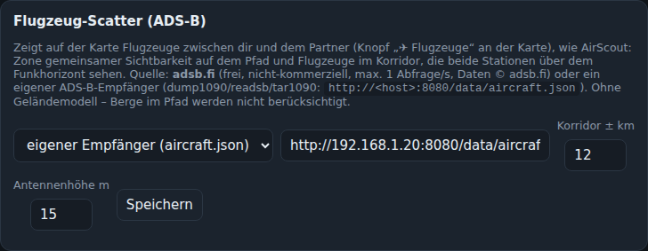

# Flugzeug-Scatter (ADS-B)

Wie AirScout zeigt BeamLog Flugzeuge zwischen dir und dem Partner und bewertet, ob sie für Aircraft-Scatter taugen. Einschalten mit **✈ Flugzeuge** an der Karte (Logger und Operator-Fenster); die Einstellung bleibt gespeichert, Aktualisierung alle 5 Sekunden.

## Darstellung

- **Grüner Balken** auf dem Pfad: Zone gemeinsamer Sichtbarkeit bei Reiseflughöhe – nur dort kann ein Flugzeug von beiden Stationen über dem Funkhorizont gesehen werden.
- **Orange Flugzeuge**: im Korridor (Standard ±12 km um den Pfad) und von beiden Stationen sichtbar – die nutzbaren („hot“).
- **Gelb**: kreuzt den Pfad in den nächsten 20 Minuten an einer Stelle, an der es hoch genug ist. **Hellblau**: beidseitig sichtbar, aber neben dem Pfad. **Grau**: außer Reichweite. **Rotbraun**: zu tief.
- Große Flugzeuge (A380, B747, B777, A350 … bzw. ADS-B-Kategorie „schwer“) erscheinen größer (✈✈) – sie reflektieren deutlich besser.
- **Hovern** über ein Flugzeug zeigt wie in AirScout: Typ und Größenklasse, Flughöhe, Geschwindigkeit, Kurs, Steigen/Sinken, die **Mindesthöhe** an seiner Position (ab der beide Stationen es über dem Funkhorizont sehen) und die **Höhenreserve** (Flughöhe minus Mindesthöhe, grün = sichtbar, rot = zu tief), Abstand vom Pfad, Elevationswinkel von beiden Stationen und – wenn es auf den Pfad zufliegt – **wann (UTC) und bei welchem Pfad-Kilometer es die Linie voraussichtlich kreuzt**, ob dieser Punkt in der Zone liegt und wie viel Reserve es dort hat. Der vorhergesagte Kreuzungspunkt wird auf dem Pfad markiert.
- Mit eingeschalteten Flugzeugen wird die Karte höher. Ein Klick auf einen Eintrag in der Liste springt mit der Karte zum Flugzeug und öffnet seine Details.
- Liste unter der Karte: zuerst die Flugzeuge im Korridor (Abstand, Pfad-km, Reserve), dann die, die bald kreuzen (Minuten, km, UTC-Zeit, Reserve am Kreuzungspunkt). Hover auf einen Eintrag zeigt dieselben Details.

- **Profil**: Seitenansicht des Pfads wie in AirScout – rote Kurve = Mindesthöhe entlang des Pfads (Funkhorizont beider Stationen), grüner Balken = Zone bei Reiseflughöhe, Punkte = Flugzeuge in ihrer Höhe. Über die Punkte hovern zeigt die Details; der Knopf „Profil“ blendet die Ansicht aus.
- Ohne Partner-Locator: Flugzeuge im Umkreis von 150 km um die eigene Station.

Flugzeuge am Boden und unter 1500 m werden ignoriert.

## Datenquellen (Verwaltung → Flugzeug-Scatter)

| Quelle | Hinweise |
|---|---|
| **adsb.fi** (Standard) | Frei, ohne Schlüssel, nicht-kommerziell, max. 1 Abfrage/s, Daten © adsb.fi. Der Server fragt nur, solange die Ebene in einem Browser eingeschaltet ist, und cached 4 s. |
| **Eigener Empfänger** | dump1090/readsb/tar1090: `http://<host>:8080/data/aircraft.json`. Gleiches Format, keine Internetabhängigkeit. |

Weitere Einstellungen: Korridorbreite (± km) und Antennenhöhe (geht in den Funkhorizont ein).

## Rechnung

Funkhorizont für ein Flugzeug in Höhe h: `d ≈ 4,12 · (√h + √Antennenhöhe)` km (4/3-Erde). Die Zone gemeinsamer Sichtbarkeit ist der Teil des Pfads, der von beiden Stationen innerhalb dieses Horizonts liegt. Für jedes Flugzeug: Querabstand zum Großkreis, Position entlang des Pfads, Entfernung zu beiden Stationen, und aus Kurs und Geschwindigkeit die Zeit bis zum Kreuzen.

**Grenzen gegenüber AirScout:** kein Geländemodell (Berge im Pfad bleiben unberücksichtigt) und keine Vorhersage über die reine Kreuzungszeit hinaus. Andere Quellen wie airplanes.live (nur auf Anfrage) oder OpenSky (anonym 400 Abfragen/Tag) sind deshalb nicht eingebaut.
