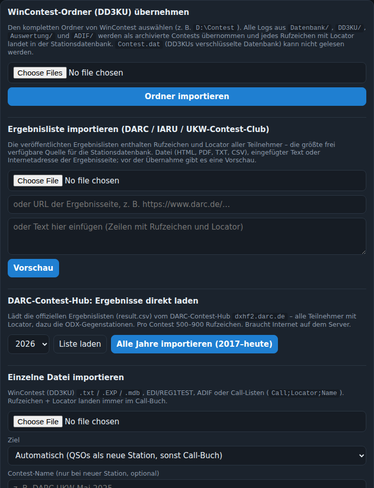
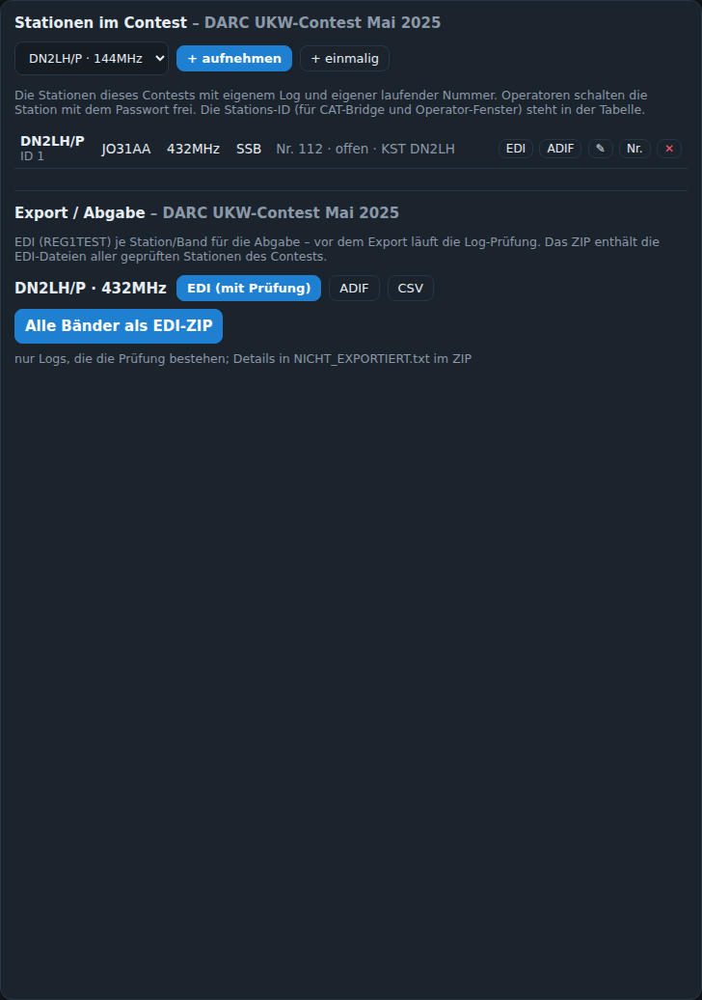

# Import und Export

Alles in der Verwaltung (Admin).

## WinContest-Ordner (DD3KU) übernehmen

Den kompletten Ordner von WinContest auswählen (z. B. `D:\Contest`). Übernommen werden alle Logs aus `Datenbank/*.mdb` und `*.txt`, `DD3KU/*.EXP`, `Auswertung/*.edi` und `ADIF/*.adi` als archivierte Contests; jedes Rufzeichen mit Locator landet in der Stationsdatenbank. Dasselbe Log in mehreren Dateien wird nur einmal übernommen.

- `.mdb`-Dateien werden rein in Python gelesen, auch verschlüsselte Jet4-Datenbanken – keine Zusatzsoftware nötig.
- `Contest.dat` (DD3KUs verschlüsselte Stationsdatenbank) kann nicht gelesen werden; die mitgelieferte Startdatenbank und die DARC-Ergebnislisten ersetzen sie.
- Das Ergebnis zeigt zuerst die Gesamtzahlen (Dateien, Contests, QSOs, Rufzeichen neu/bekannt), Details je Datei ausklappbar.

Kommandozeile: `ContestLogger-Import "D:\Contest" --db data\contestlogger.db`.

## Einzelne Datei importieren

Nimmt WinContest `.txt`/`.EXP`/`.mdb`, EDI/REG1TEST, ADIF oder Call-Listen (`Call;Locator;Name[;DOK]`). Rufzeichen und Locator aller Einträge landen **immer** in der Stationsdatenbank – das Ziel entscheidet nur, was mit den **QSOs** passiert:

| Ziel | Was passiert |
|---|---|
| **Automatisch** (Standard) | Enthält die Datei QSOs, wird ein **neuer Contest** mit einer **neuen Station** angelegt (Name, Zeitraum, Rufzeichen, Locator und Band aus dem Dateikopf; bei einem eigenen Contest-Namen im Feld darunter wird der genommen). Enthält sie nur Rufzeichen/Locator (Call-Liste), geht alles nur in die Stationsdatenbank. Richtig für alte Logs, die als Archiv übernommen werden sollen. |
| **Nur ins Call-Buch** | Die QSOs werden **nicht** als Log übernommen, nur Rufzeichen, Locator und DOK der Gegenstationen wandern in die Stationsdatenbank. Richtig für fremde Logs oder Listen, deren QSOs euch nicht gehören. |
| **QSOs in bestehende Station übernehmen** | Die QSOs werden der **gewählten Station** des gewählten Contests hinzugefügt (Band der Station, wenn die Datei keins nennt). Schon vorhandene QSOs (gleiches Rufzeichen und gleiche Zeit) werden übersprungen, die laufende Nummer zählt weiter. Richtig, um ein Papier-/Zweitlog nachzutragen oder ein Backup-Log in eine laufende Station zu mischen. |

Hinweise: Beim automatischen Import braucht die Datei den eigenen Locator im Kopf (EDI `PWWLo`, ADIF-Kopf), sonst „Zielstation auswählen“. EDI (Spalte „Exchange received“), ADIF (`DARC_DOK`, `SRX_STRING`) und Call-Listen mit DOK-Spalte bringen den DOK/OV mit; er landet im QSO und in der Stationsdatenbank. Das Ergebnis zeigt Anzahl QSOs, Call-Buch-Einträge und Warnungen (übersprungene Zeilen).

## Ergebnislisten (DARC / IARU / UKW-Contest-Club)

Nur im Betreuer-Modus sichtbar (`MAINTAINER=1` in `contestlogger.env`), siehe [Stationsdatenbank](Stationsdatenbank.md#zentrale-pflege-wer-importiert-was).

Veröffentlichte Ergebnislisten enthalten Rufzeichen und Locator aller Teilnehmer. Datei (HTML, PDF, TXT, CSV), eingefügter Text oder die URL der Ergebnisseite; vor der Übernahme gibt es eine Vorschau.

## DARC-Contest-Hub direkt laden

Nur im Betreuer-Modus sichtbar.

Lädt die offiziellen `result.csv`-Dateien vom DARC-Contest-Hub (`dxhf2.darc.de`) für ein Jahr oder alle Jahre seit 2017 – pro Contest 500–900 Rufzeichen mit Locator, dazu die ODX-Gegenstationen. Braucht Internet auf dem Server.

## Export / Abgabe

Verwaltung → **Export / Abgabe** (je Contest):

| Knopf | Ergebnis |
|---|---|
| EDI (mit Prüfung) | REG1TEST-Datei der Station/des Bandes für die Abgabe. Vorher läuft die [Log-Prüfung](Log-Pruefung.md); mit Fehlern exportiert nur der Admin nach Rückfrage. |
| ADIF | Alle QSOs der Station als ADIF (mit Frequenz, wenn CAT lief; DOK als `DARC_DOK`/`SRX_STRING`). |
| CSV | Tabelle. |
| Cabrillo | Cabrillo 3.0 (`.cbr`) für Auswerter, die kein EDI annehmen: Kopf mit Kategorie, Locator, Wertung, Adresse; QSO-Zeilen mit RST, Nummer, Locator und ggf. DOK; Dupes als `X-QSO`. |
| Alle Bänder als EDI-ZIP | Die EDI-Dateien aller geprüften Stationen des Contests; nicht bestandene Logs stehen in `NICHT_EXPORTIERT.txt`. |

Der EDI-Kopf nimmt die Angaben aus der Station (Wertungsgruppe, Club, Verantwortlicher, Technik). Jeder Export steht im Aktionsprotokoll.

## Stationsdatenbank

Export als CSV, Export im Repo-Format und Abgleich mit dem Repo: siehe [Stationsdatenbank](Stationsdatenbank.md).
