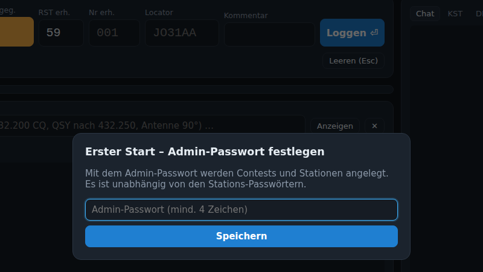
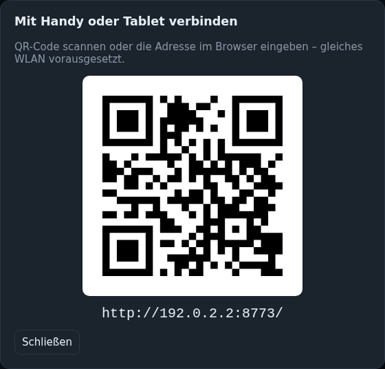

# Installation

BeamLog gibt es als **portable Version** (kein Python nötig) für Windows, Linux und macOS sowie als Quellcode.
Die Programmdateien heißen weiterhin `ContestLogger…` (früherer Name) – so funktioniert die eingebaute Update-Funktion auch für ältere Installationen.

## Portable Version (empfohlen)

1. Das passende ZIP vom [Release](https://github.com/NoobKeksTV/ContestLogger/releases/latest) laden:
   `ContestLogger-<version>-windows-x86_64.zip`, `…-linux-x86_64.zip` oder `…-macos-arm64.zip`.
2. ZIP entpacken. Im Ordner liegen:

   | Datei | Zweck |
   |---|---|
   | `ContestLogger(.exe)` | Server und Oberfläche – das Hauptprogramm |
   | `ContestLogger-CAT(.exe)` | Bridge zum Funkgerät (Hamlib rigctld / flrig), meldet Frequenz, sendet CW |
   | `ContestLogger-Import(.exe)` | Kommandozeilen-Import eines alten WinContest-Ordners |
   | `start.sh` / `ContestLogger-Port8080.bat` | Startskripte |
   | `data/` | Datenbank, Backups, eigene Sprachdateien – **das ist alles, was gesichert werden muss** |
   | `contestlogger.env.example` | Vorlage für dauerhafte Einstellungen (als `contestlogger.env` daneben ablegen) |
   | `deploy/` (nur Linux) | Dienst- und nginx-Dateien für einen Debian-Server, siehe [Deploy](Deploy.md) |
   | `START.txt`, `README.md` | Kurzanleitung |

3. `ContestLogger.exe` doppelklicken (Windows) bzw. `./ContestLogger` starten (Linux/macOS). Der Server läuft auf Port 8000, unter Windows öffnet sich der Browser automatisch.
4. Andere Rechner im LAN: die beim Start angezeigte Adresse eingeben (z. B. `http://192.168.1.10:8000`) oder den QR-Code über das 📱-Symbol im Kopf scannen.

Beim allerersten Start fragt die Oberfläche nach einem **Admin-Passwort**. Damit werden Stationen und Contests verwaltet; Operatoren brauchen es nicht.



Der QR-Code (📱 im Kopf) zeigt die Adresse für Handy und Tablet:



### Optionen

```
ContestLogger --port 8080                  # anderer Port
ContestLogger --host 127.0.0.1             # nur lokal (z. B. hinter nginx)
ContestLogger --db D:\Contest\data\log.db  # andere Datenbank
ContestLogger --backup-min 5               # Sicherung alle 5 Minuten (0 = aus, Standard 15)
ContestLogger --public-url http://contest.local/   # Adresse für QR-Code und Links
```

### Dauerhafte Einstellungen: `contestlogger.env`

Statt jedes Mal Optionen anzugeben, `contestlogger.env.example` nach `contestlogger.env` kopieren (neben das Programm) und die Werte eintragen:

```ini
HOST=0.0.0.0          # 127.0.0.1 = nur lokal
PORT=8000
#DB=D:\Contest\log.db
BACKUP_MIN=15
#PUBLIC_URL=http://contest.local/
OPEN_BROWSER=1        # Windows: Browser beim Start öffnen
#MAINTAINER=1         # nur für den Betreuer der zentralen Stationsdatenbank
```

Die Datei wird beim Start gemeldet („Konfiguration: …“). Reihenfolge: Kommandozeile überstimmt Umgebungsvariablen `CONTESTLOGGER_<KEY>` (z. B. `CONTESTLOGGER_PORT=8080`), diese überstimmen die Datei. Ein anderer Ort geht mit `--config /pfad/datei.env` oder `CONTESTLOGGER_CONFIG`. Auf einem Server liegt die Datei unter `/etc/contestlogger/contestlogger.env`, siehe [Deploy](Deploy.md).

Umzug auf einen anderen Rechner: einfach den ganzen Ordner kopieren. Die Datenbank liegt in `data/contestlogger.db`, Sicherungen in `data/backup/`.

### Linux: Hinweis zu glibc

Das Linux-Binary wird auf Ubuntu 22.04 gebaut und läuft auf Debian 12 (Bookworm), Ubuntu 22.04 und allem Neueren. Auf älteren Systemen (Debian 11) erscheint ein `GLIBC`-Fehler; dort die Quellcode-Variante nutzen.

### macOS

Beim ersten Start blockiert Gatekeeper eventuell das Programm: Rechtsklick → Öffnen, oder `xattr -d com.apple.quarantine ContestLogger`.

## Aus dem Quellcode

```bash
git clone https://github.com/NoobKeksTV/ContestLogger.git
cd ContestLogger
python3 -m venv .venv && . .venv/bin/activate      # Windows: .venv\Scripts\activate
pip install -r requirements.txt
python run.py                                      # http://localhost:8000
```

Voraussetzung: Python 3.11 oder neuer. Tests: `python -m pytest -q`. Portable Pakete selbst bauen: `python build_tools/build.py` (erzeugt `dist/ContestLogger-<version>-<os>-<arch>.zip`).

## Firewall

Der Server lauscht auf TCP-Port 8000 (bzw. dem gewählten Port). Unter Windows erscheint beim ersten Start die Firewall-Abfrage; „privates Netzwerk“ zulassen, sonst kommen andere Rechner nicht drauf.
