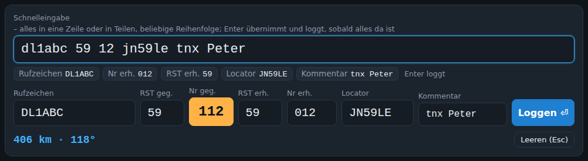
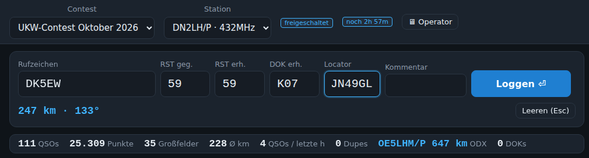

# Loggen


## Das Eingabeformular

| Feld | Hinweise |
|---|---|
| **Rufzeichen** | Wird automatisch in Großbuchstaben gesetzt. Beim Tippen erscheinen Vorschläge aus der Stationsdatenbank und allen eigenen Logs mit Locator, Entfernung, Richtung und „schon gearbeitet“-Hinweis. |
| **RST geg. / RST erh.** | Vorbelegt mit 59 (bzw. 599 bei CW). Tab, Enter und Leertaste überspringen die Felder – ändern per Mausklick. |
| **Nr geg.** | Laufende Nummer, automatisch hochzählend, orange hervorgehoben. Rücksetzen über den Knopf „Nr. zurücksetzen“ oder in der Verwaltung. |
| **Nr erh.** | Empfangene Nummer. |
| **DOK erh.** | DOK/Ortsverband der Gegenstation – nur bei Contests mit Austausch „DOK/OV“ oder „Nummer + DOK“ (siehe unten). |
| **Locator** | Wird aus der Stationsdatenbank vorbelegt (grau = automatisch, wird bei eigener Eingabe überschrieben). Hat ein Rufzeichen mehrere bekannte Standorte, erscheinen sie darunter zur Auswahl. |
| **Kommentar** | Frei. |

Unter dem Formular: Entfernung in km und Richtung in Grad, Dupe-Warnung („⚠ DL8NAS bereits gearbeitet um 10:12 UTC (JN59LE) – DUPE!“) und Plausibilitätshinweise (z. B. deutsches Rufzeichen mit Locator im Ausland, oder Stationsdatenbank kennt den Partner mit anderem Locator).

## Schnelleingabe: alles in eine Zeile

Wer lieber tippt als Felder anspringt, schaltet unter **⚙ Einstellungen** (oben rechts) die **Schnelleingabe** ein – je
Browser, nicht je Station; jeder Operator entscheidet selbst. Über den Eingabefeldern (oder darunter – ebenfalls in den
Einstellungen wählbar) erscheint dann eine Zeile, in die alles in **beliebiger Reihenfolge** kommt, getrennt durch
Leerzeichen (oder Komma):

```
DL1ABC JO31AA 012 57 G01
57 012 g01 jo31aa dl1abc
dl1abc 59 12 jn59le tnx Peter
```



BeamLog ordnet jedes Stück selbst zu und füllt live die normalen Felder; darunter steht, was erkannt wurde
(*Rufzeichen · Nr erh. · RST erh. · DOK erh. · Locator · Kommentar*), fehlende Angaben gestrichelt, dahinter „Enter
loggt“ bzw. „noch fehlt: …“. **Esc** leert alles. Die eigenen Angaben (*RST geg.*, *Nr geg.*) verändert die
Schnelleingabe nie.

**Enter übernimmt – auch in Teilen.** Man muss nicht alles in eine Zeile schreiben: Enter übernimmt das Getippte ins
QSO und leert die Zeile für den nächsten Teil. Sobald alles Nötige da ist – Rufzeichen, Locator und je nach Contest
Nr erh. und/oder DOK erh. –, loggt Enter. Beispiel:

```
DL1ABC ⏎        übernommen, Locator kommt aus der Stationsdatenbank – noch fehlt: Nr erh.
012 57 ⏎        vollständig → geloggt
```

Ein neuer Teil ersetzt den übernommenen Wert im selben Feld (zum Korrigieren einfach nochmal tippen, z. B. einen
anderen Locator), ein weiterer Kommentar wird angehängt. Ist die Nummer schon übernommen, gilt eine einzelne
RST-Zahl (`57`) als RST. **Enter auf leerer Zeile** loggt auch ohne Nr erh., sobald Rufzeichen und Locator (und bei
DOK-Contests der DOK) stehen. Wer zwischendurch ein Feld von Hand ändert, übernimmt damit den Stand der Zeile.

| Stück | Erkannt als |
|---|---|
| `JO31AA`, `JO31` | Locator (Maidenhead, 4 oder 6 Stellen) |
| `DL1ABC`, `OK1KZ/P`, `DL/PA3XYZ` | Rufzeichen |
| `57`, `59` (Sprechfunk) bzw. `579`, `599` (CW) | RST erh. – nur Rapporte, die mit 5 beginnen, gelten als RST |
| andere Zahlen, `012`, `7`, `123` | Nr erh. (führende Null = immer Nummer; gespeichert dreistellig, z. B. `007`) |
| `G01`, `Z21` | DOK erh. (nur bei Contests mit DOK im Austausch) |
| alles andere | Kommentar (Schreibweise bleibt erhalten) |

- Eine einzelne Zahl ist die Nummer (bei reinem DOK-Austausch der RST). RST erh. ohne Angabe bleibt 59.
- Zwei Zahlen: die plausible RST-Zahl ist der RST. Sind beide plausibel (`57 55`), gilt `59`/`599` als RST, sonst die
  zweite – mit einem ⚠-Hinweis „RST oder Nummer?“. Eindeutig machen: **`r44`** = RST (auch seltene Rapporte wie 44),
  **`#12`** oder `nr12` = Nummer.
- Fehlt der Locator, nimmt BeamLog ihn (und den DOK) aus der [Stationsdatenbank](Stationsdatenbank.md), sobald das
  Rufzeichen bekannt ist (grün markiert). Ohne Locator bzw. ohne DOK (bei DOK-Contests) wird nicht geloggt.
- Die normalen Felder bleiben bedienbar, etwa um nach dem Tippen noch etwas zu korrigieren.

## Austausch je Contest: Nummer, DOK oder beides

Was geloggt werden muss, legt der Contest fest (Verwaltung → Contest → **Austausch**):

| Austausch | Felder im Logger | Beispiel |
|---|---|---|
| RST + laufende Nummer | Nr geg., Nr erh. | DARC-UKW-Contest, IARU-Region-1-Contests |
| RST + DOK/OV | DOK erh. (die Nummernfelder sind ausgeblendet) | Köln-Aachen-Contest |
| RST + Nummer + DOK/OV | Nr geg., Nr erh., DOK erh. | Contests mit beidem |



Der DOK wird aus der [Stationsdatenbank](Stationsdatenbank.md) vorbelegt (grün umrandet), sobald das Rufzeichen bekannt ist, und mit jedem QSO dort gelernt. Tab, Enter und Leertaste springen Rufzeichen → Nr erh. → DOK erh. → Locator; fehlt die Nummer im Contest, direkt zum DOK. Der eigene DOK steht bei der Station in den EDI-Angaben („Eigener DOK/OV bzw. Austausch“) und landet im EDI-Kopf als `PExch`; der empfangene DOK steht in der EDI-QSO-Zeile (Spalte „Exchange received“), im ADIF (`DARC_DOK`, `SRX_STRING`) und in der CSV. Die Statistikzeile zählt die verschiedenen DOKs, die Log-Prüfung warnt bei fehlendem DOK. Das Operator-Fenster zeigt das DOK-Feld statt bzw. neben den Nummern.

## Ablauf mit der Tastatur

Tab, Enter und Leertaste gehen alle denselben kurzen Weg über die nötigen Felder: **Rufzeichen → Nr erh. (→ DOK erh.)
→ Locator → Kommentar**. Die mit 59 vorbelegten RST-Felder werden übersprungen; wer einen anderen Rapport braucht,
klickt hinein (Umschalt+Tab geht zurück).

- **Rufzeichen tippen → Leertaste** (oder Tab/Enter) springt zu *Nr erh.*; mit der Leertaste wird gleichzeitig die Stationsdatenbank (und ggf. HamQTH/QRZ) abgefragt und der Locator vorbelegt.
- **Nr erh. → Leertaste** springt zum Locator, **Locator → Leertaste** zum Kommentar.
- **Enter** loggt, sobald Rufzeichen und Locator stehen (in *Nr erh.*, *DOK erh.*, *Locator* oder *Kommentar*); sonst geht es ins nächste nötige Feld.
- **Esc** leert das Formular.
- Pfeiltasten blättern in den Vorschlägen, Enter/Tab übernimmt den markierten Vorschlag.

Alle Kürzel unter [Tastenkürzel](Tastenkuerzel.md) oder mit F1 im Programm.

## Was beim Loggen passiert

Ein Doppel-QSO wird beim Tippen des Rufzeichens als rotes Banner über dem Formular angezeigt (wie im Operator-Fenster), mit Zeit und Locator des früheren QSOs.


- Zeit in **UTC**, Entfernung nach WinContest-Methode (angefangene km = Punkte), Großfeld, Land (DXCC).
- **Dupe-Erkennung** je Rufzeichen und Band: Dupes werden gespeichert, zählen aber 0 Punkte und erscheinen durchgestrichen.
- Das Rufzeichen mit Locator landet in der **Stationsdatenbank** (siehe [Stationsdatenbank](Stationsdatenbank.md)).
- Alle anderen Browser bekommen das QSO sofort (Ton „Tick“), das Operator-Fenster hebt es grün hervor.
- Bei laufender CAT-Bridge wird die Frequenz zum QSO gespeichert (ADIF `FREQ`).

## Töne

🔔 im Kopf schaltet die Töne: Pling beim eigenen QSO, Brummen bei Dupe, Ping bei Chat/DM/„an mich“, Tick wenn eine andere Station loggt. Töne sind gedrosselt (max. ein Hinweiston je 1,5 s) und kommen nur aus dem Hauptfenster, nicht aus ausgepoppten Fenstern.

## Karte und Antennenrichtung

Die Karte unter dem Formular zeigt die eigene Station (blau), das Feld des Partners (rot) und die Richtungslinie mit Pfeil. Beschriftung: Rufzeichen, km, Grad. Kacheln kommen von OpenStreetMap (oder einem eigenen Kachelserver, Verwaltung → Karte); ohne Internet funktionieren Linien und Marker trotzdem. Mit „✈ Flugzeuge“ kommt die ADS-B-Ebene dazu, siehe [Flugzeug-Scatter](Flugzeug-Scatter.md).

## Wertung

Die Punkte folgen der Wertung des Contests (Verwaltung → Contest): Standard ist 1 Punkt je km (IARU Region 1 / DARC-UKW). Alternativ zählt jedes QSO einen festen Wert, und ein Multiplikator (Großfelder, DOKs oder beides) wird auf die Summe angewendet – z. B. „1 Punkt je QSO × DOKs“ für den Köln-Aachen-Contest. Die Statistikzeile zeigt die Gesamtwertung; Hover auf „Punkte“ zeigt Formel und Multiplikator. EDI (`CToSc`), Cabrillo (`CLAIMED-SCORE`), Scoreboard und Statistik verwenden dieselbe Wertung.

## Statistikzeile

Direkt unter dem Formular: QSOs, Punkte, Großfelder, Ø km, QSOs in der letzten Stunde, Dupes, ODX. Aktualisiert sich live.

## Letzte QSOs, Bearbeiten, Löschen

Die Liste unter der Karte zeigt die letzten QSOs mit ✎ (bearbeiten) und ✕ (löschen). Beim Bearbeiten wandern die Werte ins Formular; Punkte und Dupes werden danach neu berechnet. Der Reiter **Log** zeigt das komplette Log mit Suche und dem Knopf „Log prüfen“.

## Hinweis für das Operator-Fenster

Das Feld über der Karte („Hinweis für das Operator-Fenster“) schickt einen Text, z. B. die Frequenz oder „QSY 432.250“, groß an das [Operator-Fenster](Operator-Fenster.md). Er bleibt je Station gespeichert, bis er mit ✕ gelöscht wird.

## Mehrere Operatoren

Mehrere Browser können dieselbe Station bedienen; die laufende Nummer vergibt der Server, Kollisionen gibt es nicht. Wer was geloggt hat, steht im Log (Spalte Op) und im Aktionsprotokoll.
