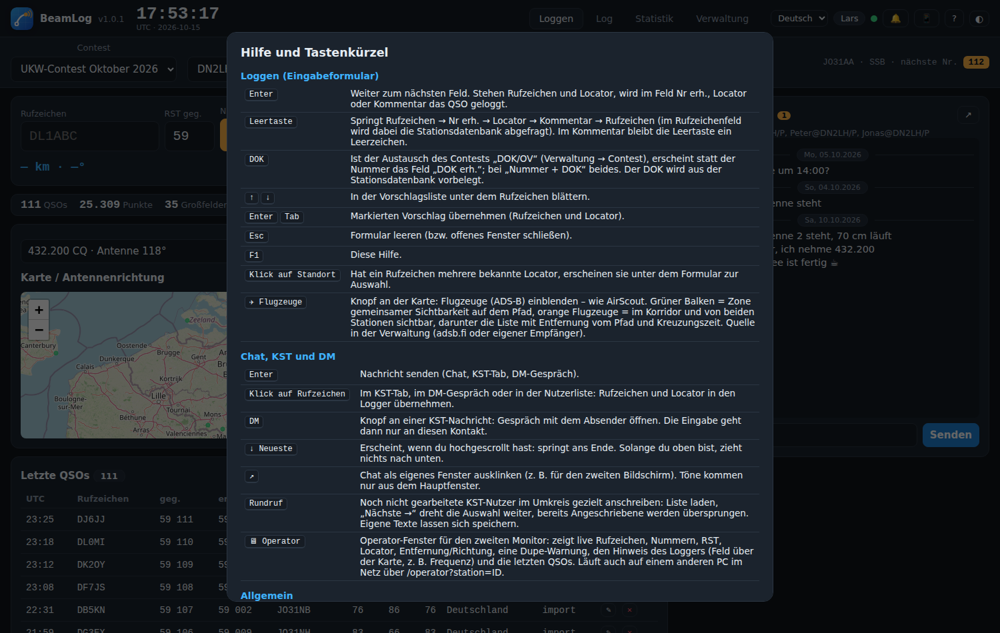

# Tastenkürzel

Im Programm jederzeit mit **F1** oder dem „?“ im Kopf abrufbar.

## Loggen (Eingabeformular)

| Taste | Wirkung |
|---|---|
| **Enter** | Weiter zum nächsten Feld. Stehen Rufzeichen und Locator, wird in *Nr erh.*, *Locator* oder *Kommentar* das QSO geloggt. |
| **Leertaste** | Springt Rufzeichen → Nr erh. → Locator → Kommentar → Rufzeichen. Im Rufzeichenfeld wird dabei die Stationsdatenbank abgefragt. Im Kommentar bleibt die Leertaste ein Leerzeichen. |
| **↑ / ↓** | In der Vorschlagsliste unter dem Rufzeichen blättern. |
| **Enter / Tab** | Markierten Vorschlag übernehmen (Rufzeichen und Locator). |
| **Esc** | Formular leeren bzw. offenes Fenster schließen. |
| **F1** | Hilfe. |
| Klick auf einen Standort | Hat ein Rufzeichen mehrere bekannte Locator, erscheinen sie unter dem Formular zur Auswahl. |

## Chat, KST und DM

| Taste / Element | Wirkung |
|---|---|
| **Enter** | Nachricht senden (Chat, KST-Tab, DM-Gespräch). |
| Klick auf ein Rufzeichen | Im KST-Tab, im DM-Gespräch oder in der Nutzerliste: Rufzeichen und Locator in den Logger übernehmen. |
| **DM** (Knopf an einer Nachricht) | Gespräch mit dem Absender öffnen; die Eingabe geht dann nur an diesen Kontakt. |
| **↓ Neueste** | Erscheint nach dem Hochscrollen und springt ans Ende. Solange man oben ist, zieht nichts nach unten. |
| **↗** | Chat als eigenes Fenster ausklinken (zweiter Bildschirm). |
| **Rundruf** | Noch nicht gearbeitete KST-Nutzer im Umkreis anschreiben; „Nächste →“ dreht die Auswahl weiter. |

## Allgemein

| Element | Wirkung |
|---|---|
| Reiter **Loggen / Log / Statistik / Verwaltung** | Eingabe, komplettes Log mit Suche und Log-Prüfung, Auswertung, Verwaltung (Admin). |
| **Contest / Station** (Leiste unter dem Kopf) | Auswahl; jede Station hat eigenes Log, eigene Nummer und eigenen KST-Chat. |
| **🖥 Operator** | Operator-Fenster für den zweiten Monitor. |
| **🔔** | Töne an/aus. |
| **📱** | Adresse des Servers als QR-Code. |
| **◐** | Hell/Dunkel. |
| **Sprache** | Oberfläche umschalten; eigene Übersetzungen über die Verwaltung. |
| **⬆ Update** | Erscheint im Kopf, wenn eine neue Version auf GitHub liegt. |
| **✈ Flugzeuge** (an der Karte) | ADS-B-Ebene ein/aus. |
