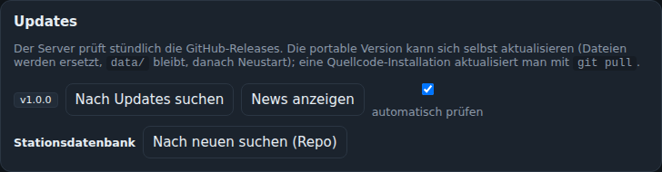
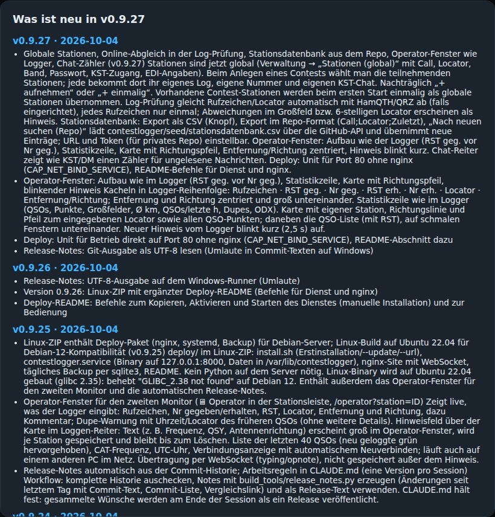

# Updates

## Update-Prüfung

Der Server prüft stündlich die GitHub-Releases (Verwaltung → Updates → „automatisch prüfen“). Liegt eine neuere Version vor, erscheint bei allen Nutzern im Kopf der grüne Knopf **⬆ v0.9.28** und ein kurzer Hinweis; der Knopf führt zur Verwaltung. „Nach Updates suchen“ prüft sofort und zeigt die Release-Notes.

Das Repo ist öffentlich, ein Token ist nicht nötig. (Nur für ein privates Fork: `GITHUB_TOKEN` in `beamlog.env` setzen.)

## Stationsdatenbank aktualisieren

„Nach neuen suchen (Repo)“ in derselben Karte holt die zentral gepflegte Stationsdatenbank aus dem Repo und übernimmt neue Rufzeichen, geänderte Locator und DOKs. Siehe [Stationsdatenbank](Stationsdatenbank.md).

## Jetzt aktualisieren (portable Version)

„Jetzt aktualisieren“ lädt das ZIP für die eigene Plattform, entpackt es, ersetzt die Programmdateien (der Ordner `data/` bleibt unangetastet), schreibt vorher eine Sicherung und startet den Server neu. Alle Browser verbinden sich automatisch wieder.

- **Linux/macOS:** die laufende Binärdatei wird in `.old` umbenannt, die neue startet per `exec`; unter systemd bleibt der Dienst erhalten.
- **Windows:** eine laufende `.exe` lässt sich nicht überschreiben; ein kleines `update.bat` wartet auf das Programmende, kopiert die Dateien und startet neu. Das Fenster schließt sich kurz und öffnet sich wieder.
- **Quellcode-Installation:** keine Selbst-Aktualisierung – `git pull && pip install -r requirements.txt`, dann Dienst neu starten.
- **Debian-Server:** alternativ neues ZIP entpacken und `sudo bash deploy/install.sh --update`.

Jedes Update steht im Aktionsprotokoll.

## Was ist neu

Ruft ein Browser den Server nach einem Update zum ersten Mal auf, erscheint „Was ist neu in v…“ mit den Änderungen seit der zuletzt gesehenen Version. „News anzeigen“ in der Verwaltung zeigt die letzten Versionen jederzeit. Grundlage ist das mitgelieferte Änderungsprotokoll (`CHANGELOG.md`), das beim Release-Build aus der Git-Historie erzeugt wird; dieselben Texte stehen in den Release-Notes auf GitHub.
