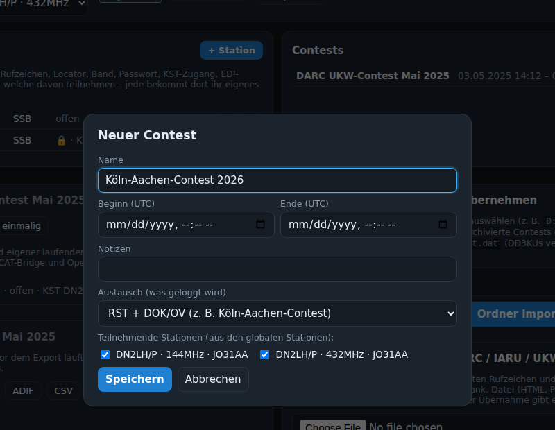
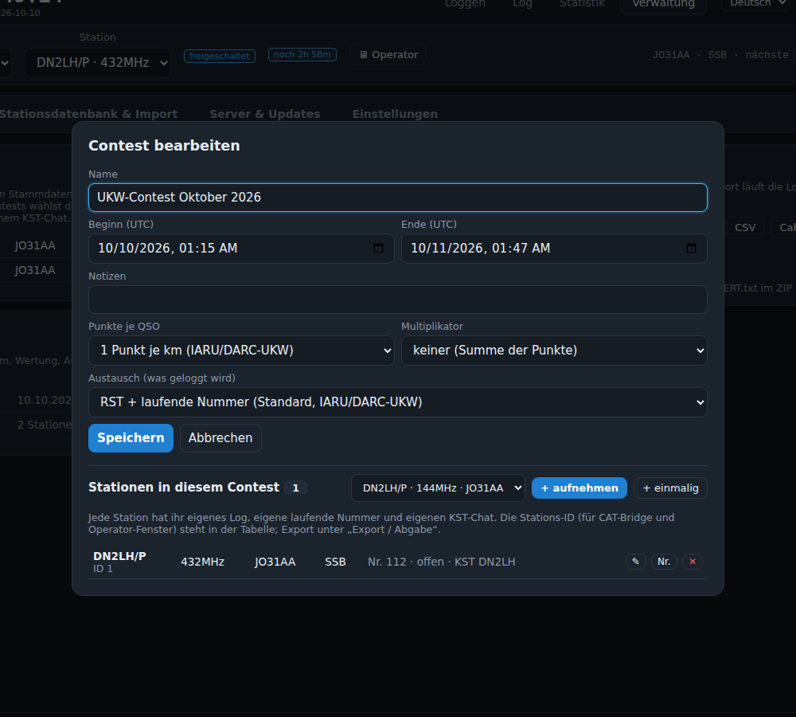
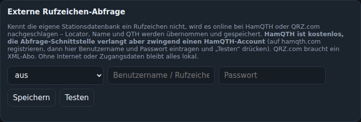

# Verwaltung

Der Reiter **Verwaltung** ist nur mit Admin-Passwort zugänglich und enthält alle Einstellungen, aufgeteilt in vier Bereiche (der zuletzt geöffnete bleibt gemerkt):

| Bereich | Karten |
|---|---|
| **Contests & Stationen** | Stationen (global), Contests (mit den Stationen je Contest im ✎-Dialog), Export / Abgabe |
| **Stationsdatenbank & Import** | Stationsdatenbank mit Kennzahlen, Auffüllen aus HamQTH/QRZ.com, WinContest-Ordner, Einzelne Datei; im Betreuer-Modus zusätzlich Ergebnislisten, DARC-Contest-Hub und Ergebnislisten-Archiv (auch automatisch) |
| **Server & Updates** | Updates (auch „Nach neuen suchen“ für die Stationsdatenbank), Backups, Aktionsprotokoll |
| **Einstellungen** | Externe Rufzeichen-Abfrage, Karte (mit Offline-Cache), Flugzeug-Scatter, Sprachen, Admin-Passwort |

## Stationen (global)
Stammdaten eurer Stationen (Rufzeichen, Locator, Band, Modus, Passwort, KST-Zugang, EDI-Angaben). Beim Anlegen eines Contests wählt ihr die teilnehmenden. Siehe [Erste Schritte](Erste-Schritte.md).

## Contests
Anlegen (mit Stationsauswahl), bearbeiten (Name, Zeitraum, Notizen, **Wertung**: Punkte je QSO (1 je km oder fester Wert) und Multiplikator (keiner, Großfelder, DOKs, beides) – bei Änderung werden alle QSOs des Contests neu bewertet; **Austausch**: laufende Nummer, DOK/OV oder beides – siehe [Loggen](Loggen.md#austausch-je-contest-nummer-dok-oder-beides)), archivieren, löschen, „EDI-ZIP“ für alle Bänder. „wählen“ macht den Contest in der Stationsleiste aktiv.

## Stationen eines Contests
Stehen im Contest-Dialog (Contests → ✎) unter den Contest-Daten: ID, Band, Locator, Nummer, Passwortstatus, KST-Login. „+ aufnehmen“ fügt eine globale Station hinzu, „+ einmalig“ eine nur für diesen Contest; je Station ✎ bearbeiten, Nr. setzen, ✕ entfernen (mit allen QSOs).

## Export / Abgabe
Je Station mit QSO-Zahl und Punkten: EDI (mit Prüfung – öffnet das Prüfergebnis, Download darin), ADIF, CSV, Cabrillo. „Alle Bänder als EDI-ZIP“ zeigt erst, welche Logs die Prüfung bestehen, und lädt dann das ZIP. Siehe [Import und Export](Import-Export.md).

## Importe
WinContest-Ordner, Ergebnislisten, DARC-Contest-Hub, einzelne Datei. Siehe [Import und Export](Import-Export.md).

## Stationsdatenbank (Callbuch)
Kennzahlen (Rufzeichen mit Locator/DOK/Name, je Land), Suche, Bearbeiten (auch DOK), Löschen, Export (CSV; Repo-Format nur im Betreuer-Modus). Der Abgleich mit dem Repo („Nach neuen suchen“) steht unter **Updates**. Siehe [Stationsdatenbank](Stationsdatenbank.md).

## Backups auf dem Server
Der Server sichert die Datenbank automatisch (nur bei Änderungen) in den Ordner `backup/` neben der Datenbank, zusätzlich beim Beenden und vor jedem Update. „Jetzt sichern“ erzeugt eine Sicherung sofort. Die Liste zeigt die vorhandenen Sicherungen. Es gibt bewusst keine Sicherung im Browser und keinen Offline-Modus: die Daten liegen nur auf dem Server.

## Updates
Update-Prüfung, Selbst-Aktualisierung, „News anzeigen“ und „Nach neuen suchen (Repo)“ für die Stationsdatenbank. Siehe [Updates](Updates.md).

## Aktionsprotokoll

Jede Änderung (QSOs, Stationen, Contests, Importe, Einstellungen, KST, Backups, Exporte, Anmeldungen) mit Zeit, Nutzername, Admin-Kennzeichen und Ergebnis; Passwörter werden maskiert. Suche, Aktualisieren, Download als Textdatei. Die gleichen Zeilen stehen auf der Server-Konsole bzw. im `journalctl`.

## Externe Rufzeichen-Abfrage

HamQTH (kostenlos, aber Account nötig) oder QRZ.com (XML-Abo) für unbekannte Rufzeichen und den Online-Abgleich in der Log-Prüfung. „Testen“ prüft die Zugangsdaten. Mit denselben Zugangsdaten füllt „Aus HamQTH / QRZ.com auffüllen“ (Stationsdatenbank & Import) fehlende Locator, DOKs und Namen der ganzen Stationsdatenbank im Hintergrund auf, siehe [Stationsdatenbank](Stationsdatenbank.md#aus-hamqth--qrzcom-auffüllen).

## Karte
Kachel-URL für die Karten (Standard OpenStreetMap). **Offline-Cache**: mit „Kacheln über den Server laden und speichern“ holt der Server die Kacheln und legt sie unter `data/tiles/` ab – alles, was einmal angezeigt wurde, bleibt ohne Internet verfügbar. „Region vorab laden“ lädt vor dem Contest einen Umkreis (Locator, Radius, Zoom bis 7–10) im Hintergrund; der öffentliche OpenStreetMap-Server erlaubt keine Massen-Downloads, daher sind Zoom ≤ 10 und ca. 4000 Kacheln je Lauf die Grenze. Für große Gebiete einen eigenen Kachelserver eintragen. „Cache leeren“ löscht die gespeicherten Kacheln.

## Flugzeug-Scatter (ADS-B)
Quelle (adsb.fi oder eigener Empfänger), Korridor, Antennenhöhe. Siehe [Flugzeug-Scatter](Flugzeug-Scatter.md).

## Sprachen
Übersetzungsvorlage herunterladen, Werte übersetzen, als `lang/<code>.json` neben der Datenbank ablegen (z. B. `data/lang/nl.json`), Server neu starten. Die Sprache erscheint dann unter ⚙ Einstellungen → Sprache der Oberfläche. Mitgeliefert: Deutsch und Englisch.

## Admin-Passwort
Ändern und Abmelden.
